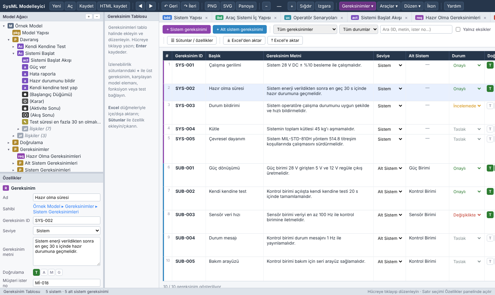
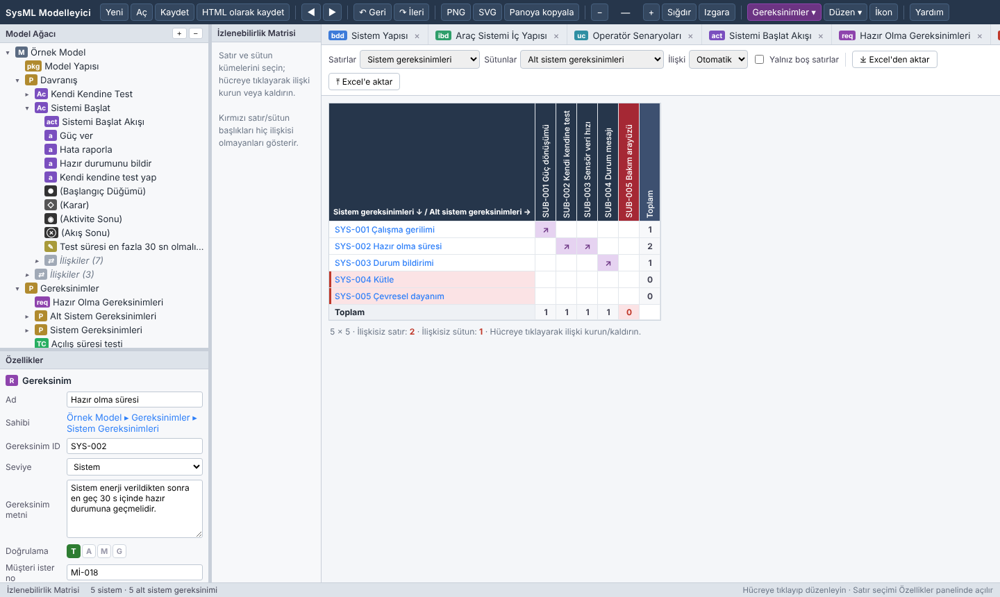
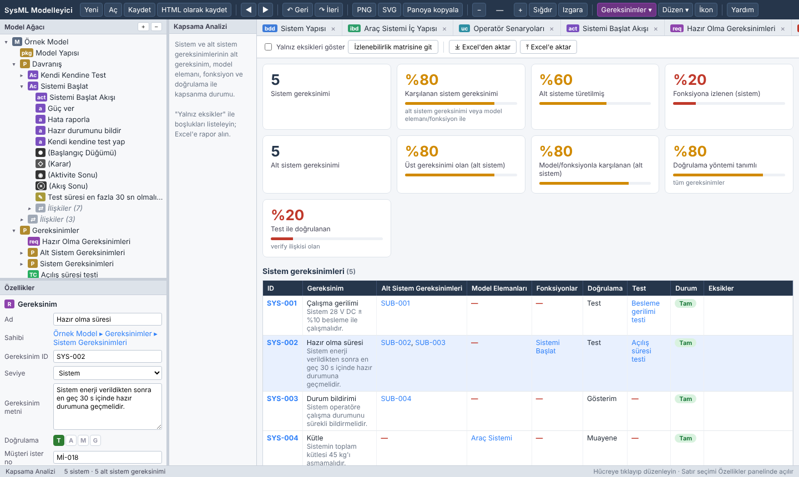
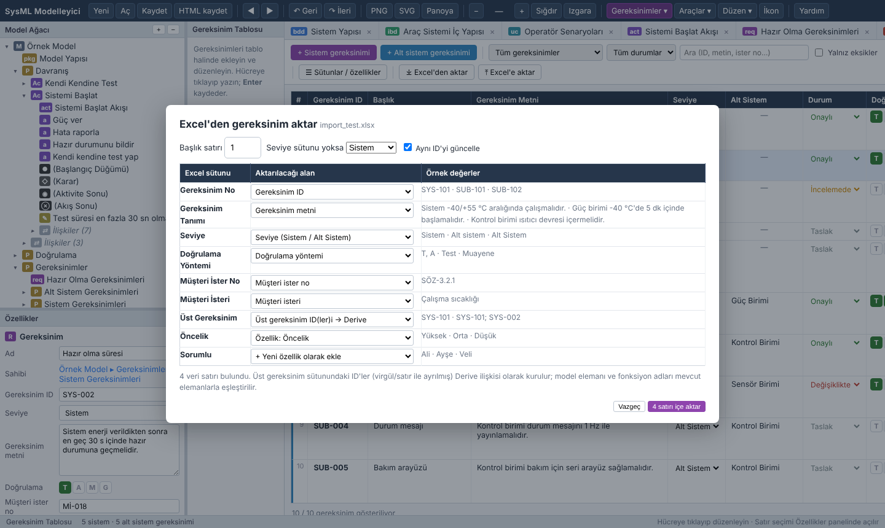
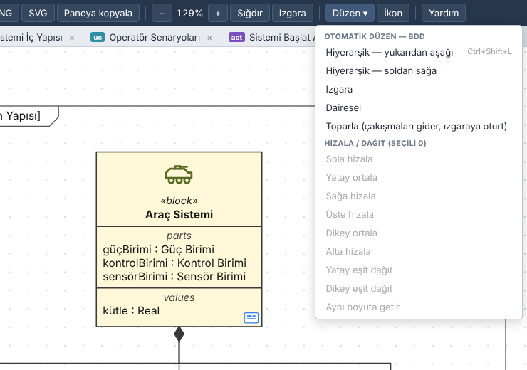
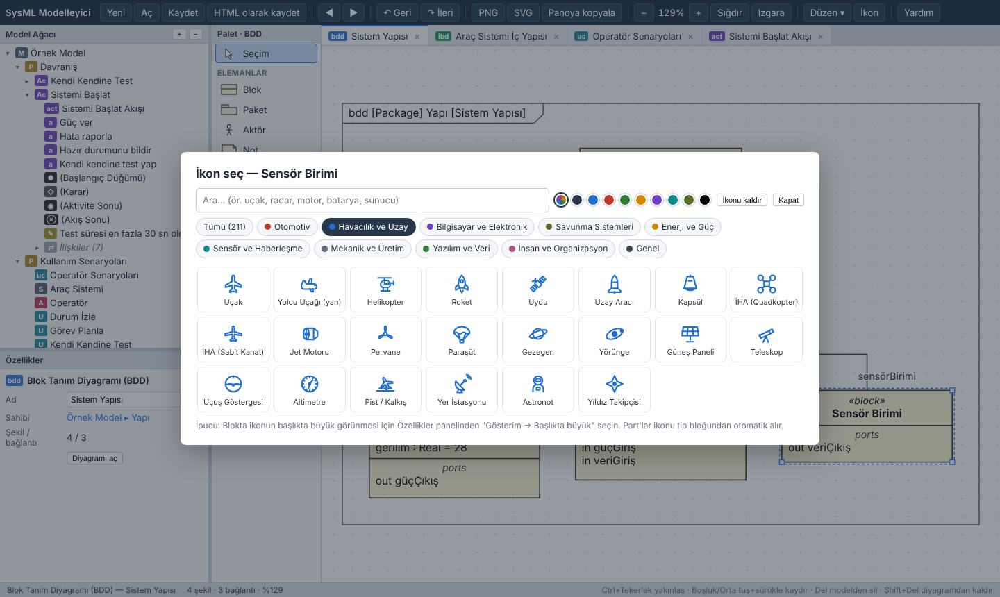
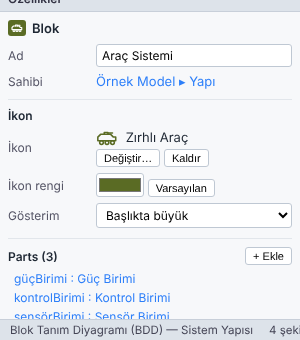

# Kullanım Kılavuzu

## İçindekiler

1. [Arayüz](#1-arayüz)
2. [Model ağacı](#2-model-ağacı)
3. [Diyagram oluşturma ve düzenleme](#3-diyagram-oluşturma-ve-düzenleme)
4. [Diyagram türleri](#4-diyagram-türleri)
5. [İç içe diyagramlar ve gezinme](#5-iç-içe-diyagramlar-ve-gezinme)
5a. [Gereksinim yönetimi ve izlenebilirlik](#5a-gereksinim-yönetimi-ve-izlenebilirlik)
5b. [Gereksinim kalitesi, durum, geçmiş ve taban çizgileri](#5b-gereksinim-kalitesi-durum-geçmiş-ve-taban-çizgileri)
5c. [Doğrulama ve test yönetimi](#5c-doğrulama-ve-test-yönetimi)
5d. [Araçlar: rapor, model doğrulama, birleştirme, ReqIF](#5d-araçlar-rapor-model-doğrulama-birleştirme-reqif)
5e. [Analiz: parametrik hesap, bütçe, simülasyon, tahsis, tablo, ilişki haritası](#5e-analiz-parametrik-hesap-bütçe-simülasyon-tahsis-tablo-ilişki-haritası)
5f. [XMI (Cameo / MagicDraw) ve şablonlar](#5f-xmi-cameo--magicdraw-ve-şablonlar)
5g. [Çevresel test profilleri](#5g-çevresel-test-profilleri)
5h. [FMEA / FMECA ve risk yönetimi](#5h-fmea--fmeca-ve-risk-yönetimi)
5i. [Arayüz yönetimi: N² matrisi ve ICD](#5i-arayüz-yönetimi-n²-matrisi-ve-icd)
5j. [Şartnameden gereksinim çıkarma, model karşılaştırma, inceleme notları](#5j-şartnameden-gereksinim-çıkarma-model-karşılaştırma-inceleme-notları)
5k. [Komut paleti, karanlık tema, durum geçiş tablosu, kullanıldığı yerler](#5k-komut-paleti-karanlık-tema-durum-geçiş-tablosu-kullanıldığı-yerler)
6. [Otomatik düzen ve hizalama](#6-otomatik-düzen-ve-hizalama)
7. [İkonlar](#7-ikonlar)
8. [Özellikler paneli](#8-özellikler-paneli)
9. [Kaydetme, açma ve paylaşma](#9-kaydetme-açma-ve-paylaşma)
10. [Görüntü olarak dışa aktarma](#10-görüntü-olarak-dışa-aktarma)
11. [Klavye kısayolları](#11-klavye-kısayolları)
12. [Sık sorulanlar](#12-sık-sorulanlar)

---

## 1. Arayüz

| Bölge | Görevi |
|---|---|
| **Araç çubuğu** (üst) | Yeni / Aç / Kaydet, gezinme (◀ ▶), geri al, **Dışa aktar ▾** (PNG/SVG/PDF/pano), yakınlaştırma, Izgara, **Harita**, **🖌 Biçim**, **Gereksinimler ▾**, **Analiz ▾**, **Araçlar ▾**, **Düzen ▾**, **İkon**, Yardım |
| **Model ağacı** (sol üst) | Modelin tamamı: paketler, bloklar, part'lar, aktörler, aktiviteler, diyagramlar, ilişkiler |
| **Özellikler** (sol alt) | Seçili elemanın adı, tipi, çokluğu, ikonu, açıklaması vb. |
| **Palet** | Açık diyagram türüne özel elemanlar ve ilişkiler |
| **Sekmeler + tuval** | Açık diyagramlar; çalışma alanı |
| **Durum çubuğu** (alt) | Diyagram bilgisi ve o anki araç için ipucu |

Paneller arasındaki ayırıcılar sürüklenerek boyutlandırılabilir.

## 2. Model ağacı

- **Sağ tık** menüsünde şunlar var:
  - Yeni eleman: Paket, Blok, Aktör, Use Case, Aktivite, Part, Value, Port…
  - Yeni diyagram
  - Yeniden adlandırma (`F2`)
  - Modelden silme (`Del`)
  - Açık diyagrama ekleme
- **Çift tık:**
  - Diyagramı açar.
  - Alt diyagramı olan bir elemanda o diyagrama gider.
  - Diğer elemanlarda dalı açar/kapatır.
- **Ağaç içinde sürükle:** Elemanı başka bir paket veya bloğun altına taşır.
- **Ağaçtan diyagrama sürükle:** Mevcut elemanı diyagramda gösterir; modelde var olan ilişkileri de otomatik çizilir.
  - IBD'ye bir **blok** bırakılırsa o tipte yeni bir *part* oluşur. Bir part'ın üzerine bırakılırsa o part'ın tipi değişir.
  - Aktivite diyagramına bir **aktivite** bırakılırsa onu çağıran bir aksiyon oluşur. Bir **blok** bırakılırsa nesne düğümü oluşur.
- İlişkiler, sahibi olan elemanın altında **İlişkiler (n)** grubunda listelenir.

## 3. Diyagram oluşturma ve düzenleme

- **Eleman ekleme:** Paletten tuvale sürükleyin ya da paletteki elemana tıklayıp tuvale tıklayın. Paletteki öğeye **çift tıklarsanız** araç sabitlenir ve art arda ekleme yapabilirsiniz; `Esc` ile bırakılır.
- **İlişki çizme:** Paletten ilişki türünü seçin, kaynak elemandan hedef elemana sürükleyin. Kurallara uymayan bağlantılar engellenir ve nedeni gösterilir.
- **Seçme:**
  - Tıklama: tek seçim
  - `Shift`/`Ctrl` + tıklama: çoklu seçim
  - Boş alanda sürükleme: alan seçimi
  - `Ctrl+A`: tümünü seçme
- **Taşıma:** Sürükleyin; ızgaraya oturur, `Alt` basılıyken ızgarasız taşınır. Ok tuşları 10 px (`Shift` ile 1 px) taşır.
- **Boyutlandırma:** Seçili şeklin köşe tutamaklarını sürükleyin.
- **Bağlantı rotası:**
  - Bağlantılar otomatik olarak elemanların etrafından dolaşır. Aynı kenara gelen bağlantılar ayrı noktalara dağıtılır, paralel hatlar üst üste binmez.
  - Düz çizgili bağlantılar (use case, durum makinesi, not bağlantısı) bir elemanı keserse dik açılı olarak etrafından dolaşır.
  - Elle ayar: seçili bağlantının ortasındaki mavi tutamak sürüklenir. Sağ tık → *Rotayı sıfırla* otomatik rotaya döndürür.
  - **Bükme noktaları:** Seçili bağlantının parçalarının ortasındaki turuncu yuvarlakları sürükleyerek bükme noktası ekleyin. Turuncu kare noktalar taşınır, çift tıklayınca silinir. *Düz* çizgide eğik (serbest açılı), *dik açılı* çizgide basamaklı çizilir. İki ucu birlikte taşınan bağlantının bükme noktaları da taşınır.
  - **Etiket taşıma:** Seçili bağlantının etiketini (ad, koşul, «stereotip», mesaj) sürükleyerek yerini değiştirin. Sağ tık → *Etiket konumunu sıfırla*.
  - Bağlantı ucunu yeniden bağlama: seçili bağlantının uç tutamacını başka bir elemana sürükleyin; model ilişkisi de güncellenir.
- **Kopyala / yapıştır:** `Ctrl+C` / `Ctrl+V`. Başka bir diyagrama yapıştırınca aynı model elemanları orada da gösterilir; aynı diyagrama yapıştırınca yeni eleman olarak kopyalanır (bloklar part, port ve değerleriyle). `Ctrl+Shift+V` her zaman yeni eleman olarak yapıştırır, `Ctrl+D` seçimi çoğaltır.
- **Ağaçtan toplu ekleme:** Ağaçta `Ctrl`/`Shift` + tık ile birden çok eleman seçip diyagrama birlikte sürükleyin; aralarındaki ilişkiler otomatik çizilir.
- **Arama:** `Ctrl+F` modeli ad, gereksinim ID ve metni, açıklama ve özellik değerlerinde arar; sonuca tıklayınca ağaçta ve diyagramda gösterilir.
- **Görünüm:** Özellikler panelindeki *Görünüm* bölümünden dolgu ve çizgi rengi, bloklarda bölmeleri (parts, references, values, ports) gizleme ve diyagram yazı boyutu ayarlanır. Aktivite diyagramında paletteki *Kulvar (yatay)* ile yatay kulvar eklenir.
- **Ad düzenleme:**
  - `F2` ya da `Alt`+çift tık ad düzenler.
  - Alt diyagramı olmayan elemanlarda düz çift tık da ad düzenler.
  - Notlarda düzenleme `Ctrl+Enter` ile bitirilir.
- **Silme:**
  - `Del`: elemanı **modelden** siler; tüm diyagramlardan kalkar.
  - `Shift+Del`: yalnızca **bu diyagramdan** kaldırır, eleman modelde kalır.
- **Biçim boyacısı (🖌 Biçim):** Bir şekil veya bağlantı seçip **Biçim**'e basın. Tıkladığınız diğer şekillere dolgu, çizgi rengi ve bölme görünümü, bağlantılara çizgi rengi ve rota türü uygulanır. Boş alana tıklayınca veya `Esc` ile çıkılır.
- **Lejant:** Her diyagram paletinde *Lejant* vardır. Öğeler her satıra `#renk açıklama` biçiminde yazılır (çizgi için `-#renk açıklama`). *Diyagramdaki renklerden doldur* düğmesi kullanılan dolgu, stereotip ve çizgi renklerini otomatik listeler.
- **Mini harita:** Diyagram ekrana sığmadığında sağ altta görünür. Tıklayarak veya sürükleyerek gezinilir. Araç çubuğundaki **Harita** ile açılıp kapatılır.
- **Yakınlaştırma:** `Ctrl` + fare tekerleği, araç çubuğundaki − / + ya da **Sığdır**.
- **Kaydırma:** Fare tekerleği, `Boşluk` + sürükleme veya orta tuşla sürükleme.

### Seçili bloğa hızlı ekleme ("+" düğmesi)

Diyagramda bir **blok, arayüz bloğu, kısıt bloğu veya sinyal** (IBD'de bir **part**) seçildiğinde sağ üst köşesinin yanında mavi bir **+** düğmesi çıkar. Aynı menü sağ tık → **Ekle / ilişkilendir (+)…** ile de açılır.

| Grup | Seçenekler |
|---|---|
| **Bölmeye ekle** | *Part property* (tip olarak var olan blok veya **yeni blok**; çokluk; BDD'de isterseniz Composition çizgisiyle tip bloğunu da gösterir), *Reference property* (paylaşımlı, Aggregation), *Value property* (ad, tip, varsayılan, birim), *Flow property* (ad, in/out/inout, tip, birim), *Port* (yön, arayüz bloğu tipi, eşlenik ~), kısıt bloğunda *Parametre* |
| **İlişki + yeni blok** | Composition → yeni parça bloğu (part adı ve çokluk ile), Aggregation, Association, Generalization → yeni alt tip / yeni üst tip, Dependency. Yeni blok kaynağın yakınında boş bir yere yerleşir. |
| **İlişki → var olan eleman** | Aynı ilişkiler için listeden bir veya birden çok hedef seçilir; diyagramda olmayan hedefler otomatik eklenir, zaten var olan ilişkiler atlanır. |
| **IBD'de part** | Port (part'ın kenarına yerleşir), value / flow property (tip bloğuna), Connector → başka part |

Eklenen öğe bloğun bölmesinde hemen görünür, model ağacında seçilir. Blok büyüyüp altındaki şekillerle çakışırsa o şekiller otomatik olarak aşağı kaydırılır. Her ekleme **Ctrl+Z** ile geri alınır; formlarda **Enter** ekler, **Esc** kapatır.

## 4. Diyagram türleri

### Blok Tanım Diyagramı (BDD)
**Elemanlar:** Blok, Arayüz Bloğu, Kısıt Bloğu, Değer Tipi, Numaralandırma, Sinyal, Paket, Aktör, Not
**İlişkiler:** Composition, Aggregation, Association, Generalization, Dependency, Not bağlantısı

- Bloklar *parts / references / values / ports* bölmelerini otomatik gösterir.
- **Composition** veya **Aggregation** çizildiğinde bütün blokta hedef blok tipinde bir *part* oluşur. Part adı hedef bloğun adından türetilir, sonradan değiştirilebilir.

### İç Blok Diyagramı (IBD)
**Elemanlar:** Part, Port, Value Property, Not
**İlişkiler:** Connector, Dependency, Not bağlantısı

- IBD bir bloğa aittir; açıldığında o bloğun part'ları, portları ve connector'ları otomatik yerleşir.
- **Port** bir part'ın üzerine bırakılınca kenarına oturur ve part'ın tipi olan bloğa eklenir; dolayısıyla BDD'de de görünür.
- Port yönü (in / out / inout) Özellikler panelinden seçilir ve port üzerinde ok olarak gösterilir.
- Part'a sağ tık → **Portları göster**: tip bloğun portlarını yerleştirir.

### Use Case Diyagramı
**Elemanlar:** Aktör, Use Case, Sistem Sınırı, Not
**İlişkiler:** Association, Include, Extend, Generalization, Dependency, Not bağlantısı

### Aktivite Diyagramı
**Elemanlar:** Aksiyon, Sinyal Gönder, Olay Kabul, Zaman Olayı, Pin, Aktivite Parametresi, Başlangıç, Aktivite Sonu, Akış Sonu, Karar, Birleştirme, Fork, Join, Nesne Düğümü, Kulvar, Kesilebilir Bölge, Not
**İlişkiler:** Control Flow, Object Flow, Dependency, Not bağlantısı

- Karar düğümünden çıkan akışa çift tıklanınca **koşul** (guard) yazılır, ör. `[başarılı]`.
- Bir aksiyon bir aktiviteyi **çağırabilir**. Çağrı Özellikler panelindeki *Çağırır* alanından kurulur ve aksiyonun sağ altında SysML "tırmık" simgesiyle gösterilir.

### Gereksinim Diyagramı (req)
**Elemanlar:** Gereksinim, Blok, Test Durumu, Not (ağaçtan aktivite, aksiyon, use case, part da bırakılabilir)
**İlişkiler:** Derive (türetilen → kaynak), Satisfy (model elemanı → gereksinim), Verify (test → gereksinim), Refine, Trace, Dependency

- Gereksinim kutusu `Id`, `Text` ve doğrulama yöntemini gösterir; sağ üstteki etiket seviyeyi (Sistem / Alt sistem) belirtir.
- Diyagramda çizilen her ilişki gereksinim tablosuna, matrise ve kapsama analizine anında yansır. Tersi de geçerlidir: tabloda kurulan bir ilişki, iki eleman da diyagramdaysa bağlantı olarak çizilebilir (sağ tık → *İlişkili elemanları göster*).

### Durum Makinesi Diyagramı (stm)
**Elemanlar:** Durum, Bölge, Başlangıç, Son durum, Seçim (choice), Kavşak (junction), Geçmiş (history), Not
**İlişki:** Geçiş (Transition)

- Durumların Özellikler panelinden `entry /`, `do /`, `exit /` davranışları yazılır.
- Geçiş etiketi `tetik [koşul] / etki` biçimindedir: *Ad* alanı tetik, *Koşul* ve *Etki* ayrı alanlardır. Bir durum kendisine de geçiş yapabilir.
- Durum makinesi bir bloğa aittir: bloğa sağ tık → *Yeni alt diyagram* veya ağaçta *Yeni diyagram → Durum Makinesi*.

### Sıralama (Sequence) Diyagramı (sd)
**Elemanlar:** Yaşam çizgisi, Birleşik parça (fragment), Not
**İlişkiler:** Senkron mesaj (dolu ok), Asenkron mesaj (açık ok), Yanıt mesajı (kesikli)

- Ağaçtan bir **blok, aktör veya part** bırakmak o tipte yaşam çizgisi oluşturur.
- Mesaj, kaynak yaşam çizgisinden hedefe sürüklenerek çizilir; bıraktığınız yükseklikte yer alır. Aynı yaşam çizgisine bırakmak kendine mesaj (self message) oluşturur.
- Seçili mesajın mavi tutamağı yukarı/aşağı sürüklenerek sıra değiştirilir; numaralar otomatik güncellenir.
- *Düzen → Sıralı yerleşim* yaşam çizgilerini yan yana dizer, mesajları eşit aralıklar.

### Parametrik Diyagram (par)
**Elemanlar:** Kısıt özelliği, Parametre, Value property, Not
**İlişki:** Binding connector

- Önce BDD paletinden bir **Kısıt Bloğu** oluşturun; Özellikler panelinden ifadesini (ör. `P = V * I`) ve parametrelerini girin.
- Kısıt bloğunu ağaçtan parametrik diyagrama bırakmak, parametreleri kenarına dizilmiş bir kısıt özelliği oluşturur.
- Bloğun value property'lerini parametrelere binding connector ile bağlayın.

### Paket Diyagramı (pkg)
**Elemanlar:** Paket, Blok, Arayüz Bloğu, Değer Tipi, Stereotip, Gereksinim, Not
**İlişkiler:** Dependency, Import

Paket şekilleri içerdikleri elemanları (türleriyle birlikte) listeler.

### Arayüzler, değer tipleri ve stereotipler (v1.7)

**Arayüz bloğu (InterfaceBlock):** BDD paletindedir. *Flow properties* bölmesinde akış özellikleri (`in`/`out`/`inout`, tip, çokluk) tanımlanır.

- Bir port'un tipi arayüz bloğu yapıldığında port yönü boş bırakılırsa akış özelliklerinden türetilir.
- Port'ta **Eşlenik (~)** işaretlenirse yönler ters çevrilir ve etiket `~GüçArayüzü` olarak gösterilir. Böylece aynı arayüz iki uçta da kullanılır.
- Port türü (standart / proxy / full) Özellikler panelinden seçilir.

**Değer tipi (ValueType), numaralandırma (Enumeration), sinyal (Signal):**

- Değer tipinde temel tip, birim ve büyüklük türü (quantity kind) girilir.
- Value property'nin *Tip* listesi modeldeki değer tiplerini ve numaralandırmaları önerir. Birim boşsa değer tipinin birimi kullanılır.
- **Araçlar ▾ → Birim / değer tipi kütüphanesini ekle (SI)** kütle, frekans, ivme (g), PSD (g²/Hz), ses basınç seviyesi (dB), sıcaklık, gerilim gibi 22 tipi "Birimler" paketine ekler.
- Numaralandırmanın değerleri her satıra bir tane yazılır.
- Sinyallerin öznitelikleri value property olarak eklenir.

**Stereotipler:** Kendi profilinizi oluşturmanızı sağlar (ör. «LRU», «COTS», «yazılımBileşeni»).

1. Herhangi bir elemanı seçin, Özellikler panelinde **Stereotipler → + Yeni**'ye basın. "Profil" paketinde, bu eleman türüne uygulanabilen yeni bir stereotip oluşur ve elemana uygulanır.
2. Stereotipi seçip **Etiketler** alanına her satıra bir etiket yazın: `ad : tip = varsayılan` (ör. `MTBF : Real = 10000`). Tip `Boolean` ise onay kutusu, bir numaralandırma adıysa açılır liste olarak sorulur.
3. **Uygulanır** listesinden hangi eleman türlerine uygulanabileceğini seçin; isteğe bağlı **dolgu rengi** verin.
4. Elemanlarda etiket değerlerini doldurun. Değerler blokta *tags* bölmesinde, stereotip adı başlıkta `«block, LRU»` olarak görünür.

### Aktivite: pin, parametre, sinyal ve kesme (v1.7)

- **Pin:** Paletten aksiyonun üzerine bırakın. Üst yarıya bırakılan pin `in`, alt yarıya bırakılan `out` olur. Object flow pinler arasında çizilir.
- **Aktivite parametresi:** Aktiviteye giriş/çıkış parametresi ekler. Bu aktiviteyi çağıran aksiyonlarda pinler parametrelerden otomatik oluşur.
- **Sinyal Gönder / Olay Kabul:** Özellikler panelinden sinyali seçin. Ağaçtan bir sinyali aktivite diyagramına bırakmak *Sinyal Gönder* aksiyonu oluşturur.
- **Zaman olayı:** Kum saati simgesidir; adına `after (5 s)` gibi zaman ifadesini yazın.
- **Kesilebilir bölge** kesikli çerçevedir. Bölgeden çıkan akışta Özellikler → *Kesme akışı* işaretlenince akış üzerinde şimşek simgesi görünür.
- Aksiyon farklı adlı bir aktiviteyi çağırıyorsa etiket `aksiyon : Aktivite` biçiminde gösterilir.

### Sıralama: fragmentler ve yürütme çubukları (v1.7)

- **Birleşik parça (fragment):** Paletten diyagrama yerleştirin. Özelliklerden operatörü seçin: `alt`, `opt`, `loop`, `par`, `break`, `critical`, `seq`, `strict`, `neg`, `ref`…
- *Operandlar* alanına her satıra bir operandın koşulunu yazın (ör. `sıcaklık > 70` / `else`). Operand ayırıcılarını seçili fragmentteki mavi tutamaklarla yukarı/aşağı taşıyın.
- Fragment taşınınca içindeki mesajlar da birlikte taşınır. *Sıralı yerleşim* düzeni fragmentleri kapsadıkları mesajlara göre yeniden boyutlandırır.
- `ref` fragmenti başka bir etkileşime başvurur: *Bağlı diyagram* alanından seçin, çift tıklayınca açılır.
- **Yürütme çubukları** senkron mesajın hedefinde açılır, aynı yaşam çizgisinden dönen yanıtla kapanır. Diyagram özelliklerinden kapatılabilir.

### Durum makinesi: bileşik durum, bölge, geçmiş (v1.7)

- Bir durumu büyütüp içine başka durumlar, başlangıç ve **Geçmiş (H / H\*)** düğümleri sürükleyin. Durum bileşik görünüme geçer (ad üstte, ayırıcı çizgi). Model ağacında iç durumlar da o durumun altına taşınır; dışarı sürüklenince geri çıkar.
- **Bölge (region)** paralel (ortogonal) bölgeler için kullanılır.
- **Kavşak (junction)** ve **seçim (choice)** sözde durumları geçişlerde kullanılabilir.
- İki durum arasındaki karşılıklı geçişler artık üst üste binmez, etiketleri iki yana yerleşir.
- Model doğrulama bileşik durumları dikkate alır: bileşik duruma giriş, içindeki başlangıçtan iç durumlara ulaşır sayılır.

## 5. İç içe diyagramlar ve gezinme

Bir elemana **çift tıklandığında**, elemanın bir alt diyagramı varsa o açılır:

| Eleman | Açılan diyagram |
|---|---|
| Blok | Bloğun IBD'si (veya sahip olduğu diğer diyagramlar) |
| Part / Nesne düğümü | Tip bloğunun diyagramı |
| Aksiyon | Çağırdığı aktivitenin diyagramı |
| Use Case | Bağlı akış (aktivite) diyagramı |
| Paket | İçindeki diyagramlar |
| Herhangi bir eleman | **Bağlı diyagram** (hiperlink) olarak seçilmiş diyagram |

- Birden fazla aday varsa seçim menüsü çıkar.
- Alt diyagramı olan şekillerin sağ alt köşesinde küçük mavi bir **diyagram simgesi** görünür. Bu simge görüntü çıktısına girmez.
- **Yeni alt diyagram:** Şekle sağ tık → *Yeni alt diyagram*. Örneğin bir aksiyon için yeni aktivite oluşturur, aksiyonun onu çağırmasını sağlar ve diyagramını açar.
- **Bağlı diyagram:** Herhangi bir elemana Özellikler panelinden veya sağ tık → *Diyagram bağla* ile bir diyagram bağlanabilir.
- **Gezinme:** Araç çubuğunda ◀ ▶, `Alt+←` / `Alt+→` ya da farenin geri/ileri tuşları.

## 5a. Gereksinim yönetimi ve izlenebilirlik

Araç çubuğundaki **Gereksinimler ▾** menüsü üç görünüm açar. Bunlar diyagram sekmeleri gibi sekmede açılır ve modelle canlı bağlıdır.

### Gereksinim tablosu

- **+ Sistem gereksinimi / + Alt sistem gereksinimi:**
  - Yeni satır ekler; ID otomatik verilir (varsayılan `SYS-001`, `SUB-001`).
  - Alt sistem gereksinimi eklerken **alt sistem adı** sorulur. Mevcut alt sistemlerden birine tıklayın ya da yeni bir ad yazın; listede modeldeki blok adları da önerilir.
  - Gereksinimler ağaçta *Gereksinimler → Sistem Gereksinimleri* ve *Gereksinimler → Alt Sistem Gereksinimleri → <alt sistem adı>* paketlerine yerleşir. Alt sistem adı değişince gereksinim ilgili pakete taşınır.
- **Alt sistem adı:** Tablodaki *Alt Sistem* sütunundan veya Özellikler panelinden değiştirilir. Bir sistem gereksinimini *Alt Sistem* seviyesine almak da adı sorar.
- **Düzenleme:**
  - Hücreye tıklayıp yazın. `Enter` kaydeder ve alt satıra geçer, `Shift+Enter` satır içinde yeni satır açar, `Esc` vazgeçer.
  - Seviye açılır listeden değiştirilir; değişince ID'yi yeniden numaralandırmayı sorar.
- **Doğrulama yöntemi:** **T** (Test), **A** (Analiz), **M** (Muayene), **G** (Gösterim) düğmeleri aç/kapa çalışır; birden fazlası seçilebilir.
- **İzlenebilirlik sütunları** (mor başlıklı):
  - Türetildiği sistem gereksinimi
  - Alt sistem gereksinimleri
  - Karşılayan model elemanları
  - Fonksiyonlar
  - Doğrulayan test
  - Kapsama durumu

  Her hücredeki **+** düğmesi arama yapılabilen bir seçim penceresi açar. İşaretleyip *Uygula* deyince ilişkiler kurulur, işareti kaldırınca silinir.
  - Test seçiminde *+ Yeni test durumu* ile doğrudan test oluşturulabilir.
- **Filtreler:**
  - Seviye listesi: *Tüm gereksinimler*, *Sistem gereksinimleri*, *Tüm alt sistemler* ve her alt sistem adıyla ayrı seçenek (ör. *Alt sistem: Kontrol Birimi*). Adı girilmemiş alt sistem gereksinimleri için de ayrı seçenek çıkar.
  - Arama (ID, metin, ister no, özellik değerleri) ve *Yalnız eksikler*.
  - Başlığa tıklamak sütuna göre sıralar.
- **Özellikler paneli:** Satıra tıklanınca gereksinimin tüm alanları ve izlenebilirliği Özellikler panelinde de açılır.

#### Sütunlar ve özel özellikler

**☰ Sütunlar / özellikler** penceresinden:
- Sütunları gizleyin veya gösterin (gizli sütunlar Excel'e aktarılmaz).
- **Yeni özellik** ekleyin (ör. *Öncelik, Durum, Sorumlu, Alt sistem, Kaynak doküman*). Her gereksinimde ayrı alan olarak tutulur, tabloda ve Excel'de sütun olur.
- Özellikleri yeniden adlandırın veya silin (silinince tüm değerleri de silinir).
- Sistem ve alt sistem **ID öneklerini** ve hane sayısını ayarlayın.

### İlişki türleri

| İlişki | Yön | Anlamı |
|---|---|---|
| **Derive** (deriveReqt) | alt sistem gereksinimi → sistem gereksinimi | Alt gereksinim, üst gereksinimden türetilmiştir |
| **Satisfy** | model elemanı / fonksiyon → gereksinim | Blok, part, use case… veya aktivite/aksiyon (fonksiyon) gereksinimi karşılar |
| **Verify** | test durumu → gereksinim | Test, gereksinimi doğrular |
| Refine / Trace | herhangi ↔ gereksinim | Detaylandırma / genel iz |
| Allocate | fonksiyon → blok/part | Fonksiyonun yapıya tahsisi (BDD ve aktivite paletinde) |

**Fonksiyon izlenebilirliği:**
- Aktiviteler ve aksiyonlar *fonksiyon* olarak kabul edilir. Bir gereksinimi karşılayan fonksiyonlar tabloda ayrı sütunda, matriste *Fonksiyonlar* kümesinde ve kapsama analizinde ayrı göstergede izlenir.
- Fonksiyonun hangi bloğa tahsis edildiği **Allocate** ile modellenir.

### İzlenebilirlik matrisi

- **Satırlar:** sistem / alt sistem / tüm gereksinimler veya tek bir alt sistemin gereksinimleri.
- **Sütunlar:** alt sistem veya sistem gereksinimleri, tek bir alt sistem, fonksiyonlar, bloklar, tüm model elemanları, test durumları, use case'ler.
- **İlişki türü:** *Otomatik* seçiliyken gereksinim × gereksinim için **Derive**, test için **Verify**, diğerleri için **Satisfy** kullanılır. İsterseniz türü elle seçin.
- **Hücreye tıklamak** ilişkiyi kurar veya kaldırır (`Ctrl+Z` ile geri alınır).
- **Kırmızı satır/sütun başlığı:** Hiç ilişkisi olmayan eleman. *Yalnız boş satırlar* yalnızca bunları gösterir.

### Kapsama analizi

**Göstergeler:**
- Karşılanan sistem gereksinimi yüzdesi
- Alt sisteme türetilmiş yüzde
- Fonksiyona izlenen yüzde
- Üst gereksinimi olan alt sistem gereksinimi yüzdesi
- Model veya fonksiyonla karşılanan yüzde
- Doğrulama yöntemi tanımlı yüzde
- Test ile doğrulanan yüzde

**Durum kuralları:**

| Seviye | Eksik | Kısmi | Tam |
|---|---|---|---|
| Sistem | Ne alt sistem gereksinimine türetilmiş ne de bir model elemanı/fonksiyon tarafından karşılanıyor | Karşılanıyor ama doğrulama yöntemi yok | Karşılanıyor ve doğrulama yöntemi var |
| Alt sistem | Hiçbir model elemanı/fonksiyon karşılamıyor | Karşılanıyor ama üst gereksinimi yok (**yetim**) veya doğrulama yöntemi yok | Hepsi tamam |

- Her satırın **Eksikler** sütunu neyin eksik olduğunu yazar. *Yalnız eksikleri göster* ile yalnızca boşluklar listelenir.
- Sayfanın sonunda **hiçbir gereksinime izlenmeyen bloklar ve fonksiyonlar** (gereksiz/fazladan tasarım adayları) listelenir.

### Excel'den içe aktarma

1. **⤓ Excel'den aktar** ile `.xlsx` veya `.csv` dosyası seçin (CSV'de `;`, `,` veya sekme ayracı ve Türkçe Windows kodlaması otomatik tanınır).
2. Birden fazla sayfa varsa sayfayı, gerekirse başlık satırını seçin.
3. Her Excel sütunu için aktarılacağı alanı kontrol edin. Başlıklar otomatik eşleşir; örneğin *"Gereksinim No"* → ID, *"Müşteri İster No"* → müşteri ister no, *"Üst Gereksinim"* → Derive. Eşleşmeyen sütunlar **yeni özellik** olarak eklenir; istemediğiniz sütunu *Yok say* yapın.
4. Dosyada seviye sütunu yoksa varsayılan seviyeyi seçin. Seviye değerinde *alt/sub/birim* geçiyorsa **Alt Sistem** sayılır. *Alt Sistem* / *Birim* / *Subsystem* başlıklı sütun alt sistem adı olarak aktarılır; alt sistem adı dolu olan satırlar seviye belirtilmemişse alt sistem gereksinimi sayılır.
5. *Aynı ID'yi güncelle* işaretliyse mevcut gereksinimler güncellenir, yeniler eklenir.

İlişki sütunları:
- **Üst gereksinim ID'leri** (virgül, noktalı virgül veya satır ile ayrılmış) Derive ilişkisi olarak kurulur.
- **Karşılayan model elemanı** ve **fonksiyon** sütunlarındaki adlar mevcut elemanlarla eşleştirilip Satisfy kurulur.
- **Doğrulayan test** adları test durumu olarak oluşturulur ve Verify kurulur.
- Bulunamayan adlar işlem sonunda bildirilir.

Doğrulama yöntemi metinleri (*T, A, Test, Analiz, Muayene, Inspection, Gösterim, Demo…*) standart değerlere çevrilir.

### Dışa aktarma ve sütun (attribute) seçimi

**Gereksinimler ▾ → Excel'e aktar… / Word'e aktar… / ReqIF olarak dışa aktar…** (ve tablodaki **⤒ Excel'e aktar**) önce bir seçim penceresi açar:

- **Sütunlar:** çıktıya girecek attribute'ları işaretleyin (standart alanlar, özel özellikler, izlenebilirlik sütunları ve *Açıklama, Paket, Son Değişiklik* gibi ek alanlar). Sırayı ▲▼ ile değiştirin. **Tablodaki görünür sütunlar** düğmesi, tabloda gördüğünüz sütunları seçer.
- **Kapsam:** tüm gereksinimler, yalnız sistem, tüm alt sistemler veya tek bir alt sistem; isterseniz iptal edilenler hariç.
- **Excel'de ek sayfalar:** izlenebilirlik matrisleri, kapsama analizi, kalite bulguları, VCRM ve test durumları ayrı ayrı açılıp kapatılır.
- **Word:** seçilen sütunlarla, sistem ve alt sistemlere göre gruplanmış bir *Gereksinim Spesifikasyonu* (.docx) üretilir; çok sütunda yatay sayfa önerilir. **Araçlar ▾ → Rapor oluştur** içindeki gereksinim tablosu da aynı seçimi kullanır.
- **ReqIF:** ID ve metin her zaman aktarılır; diğer attribute'lar seçime göre eklenir.

Seçim modelle birlikte kaydedilir; bir sonraki dışa aktarmada aynı sütunlar hazır gelir.

Excel çıktısı tek bir `.xlsx` dosyasıdır:

| Sayfa | İçerik |
|---|---|
| Gereksinimler | Seçilen sütunlar (özel özellikler ve izlenebilirlik dahil), filtreli başlık, renkli kapsama durumu |
| Sistem-Alt Sistem | Sistem × alt sistem türetme matrisi (X) |
| Gereksinim-Fonksiyon | Gereksinim × fonksiyon karşılama matrisi |
| Gereksinim-Blok | Gereksinim × blok karşılama matrisi |
| Kapsama Analizi | Gösterge özetleri, her gereksinimin kapsama durumu, eksikleri ve doğrulama durumu |
| Kalite | Kalite denetimi bulguları (önem, bulgu) |
| VCRM | Doğrulama çapraz referans matrisi |
| Test Durumları | Tüm test alanları ve doğruladığı gereksinimler |

Dışa aktarılan dosya tekrar içe aktarılabilir. Ortak ID'ler güncellenir ve ilişkiler korunur; Excel'de toplu düzenleme yapıp geri almak için kullanılabilir.

## 5b. Gereksinim kalitesi, durum, geçmiş ve taban çizgileri

### Durum iş akışı

Her gereksinimin bir **durumu** vardır: *Taslak → İncelemede → Onaylı → Değişiklikte → İptal*. Tabloda **Durum** sütunundan veya Özellikler panelinden değiştirilir; tablo duruma göre filtrelenebilir.

- **Onaylı** bir gereksinimin başlığı, metni, doğrulama yöntemi, seviyesi veya alt sistemi değişirse durum otomatik olarak **Değişiklikte** olur.
- **İptal** edilen gereksinimler kapsama analizine, VCRM'e ve kalite raporuna girmez.

### Kalite denetimi

Gereksinim metinleri INCOSE yazım kurallarına göre otomatik denetlenir. Tablodaki **Kalite** sütununda rozet, Özellikler panelinde uyarı listesi görünür; tüm bulgular **Gereksinimler ▾ → Kalite raporu** görünümündedir.

Kalite raporu çubuğundaki **Yazım kuralı** seçimi modelle kaydedilir: *"-ecek / -acak / -ecektir / -acaktır" ile biter* (varsayılan), *"-malıdır / -melidir" ile biter* veya *ikisi de kabul edilir*.

| Kural | Örnek |
|---|---|
| Cümle sonu | Türkçe gereksinim cümlesi **"-ecek / -acak / -ecektir / -acaktır"** ile bitmelidir (ör. *"…28 V ile çalışacaktır."*, *"…45 kg'ı aşmayacaktır."*). "-malıdır / -melidir" ile biten cümle için doğru biçim önerilir (*çalışmalıdır → çalışacaktır*). Sondaki parantez içi açıklamalar (*bkz. Tablo 3*) dikkate alınmaz; İngilizce *shall* de kabul edilir. |
| Birden fazla ister | Birden fazla cümle ya da "ve / veya" ile bağlanmış birden çok zorunluluk fiili (*"…kaydedecek ve iletecektir."*) |
| Belirsiz ifade | uygun, yeterli, hızlı, kolay, kullanıcı dostu, vb., ve/veya… |
| Belirlenmemiş değer | TBD, TBC, belirlenecek |
| Birimsiz sayı | "30 ağırlıkta" (yüzde ve standart/yöntem numaraları hariç) |
| Aşırı uzun metin | Bölünmesi önerilir |
| Yinelenen ID / çok benzer gereksinim | Aynı ID veya metni %72'den fazla örtüşen gereksinimler |

### Değişiklik geçmişi

Gereksinim alanlarındaki ve üst gereksinim bağlantılarındaki her değişiklik **kim, ne zaman, eski → yeni değer** olarak kaydedilir. Özellikler panelindeki **Gerekçe** alanına yazdığınız metin (ör. *ECR-012*) sonraki değişikliklere eklenir. Metin değişiklikleri kelime düzeyinde renkli gösterilir. Tüm geçmiş: **Gereksinimler ▾ → Değişiklik geçmişi** (Excel'e aktarılabilir). Kullanıcı adınızı **Gereksinimler ▾ → Kullanıcı adım** ile ayarlayın.

### Taban çizgileri (baseline)

**Gereksinimler ▾ → Taban çizgileri** görünümünde **+ Taban çizgisi oluştur** ile gereksinim setini adla dondurun (ör. *Rev-A (SRR)*). İki taban çizgisini veya bir taban çizgisini güncel modelle karşılaştırın: eklenen, silinen ve değişen gereksinimler alan alan listelenir. Fark raporu Excel'e aktarılabilir.

### Etki analizi

Bir gereksinime veya model elemanına sağ tıklayıp (ya da Özellikler → **⇶ Etki analizi**) değişikliğin etkileyeceği alt/üst gereksinimleri, karşılayan elemanları, testleri ve diyagramları ağaç halinde görün.

## 5c. Doğrulama ve test yönetimi

### Test durumu alanları

Test durumu (TestCase) seçildiğinde Özellikler panelinde şu alanlar bulunur: prosedür no, yöntem (Test / Analiz / Muayene / Gösterim), doğrulama seviyesi (Birim, Entegrasyon, Alt Sistem, Sistem, Kabul (FAT), Saha (SAT), Kalifikasyon), test edilen birim, standart/referans, sorumlu, planlanan başlangıç ve bitiş, sonuç (*Planlandı, Yapılmadı, Geçti, Kaldı, Koşullu*), sonuç tarihi ve rapor no. Sonuç girildiğinde sonuç tarihi boşsa bugün atanır. Gereksinim diyagramında test şeklinin köşesinde sonuç rozeti görünür.

### Doğrulama durumu

Her gereksinimin doğrulama durumu, Verify ile bağlı testlerin sonucundan hesaplanır:

| Durum | Koşul |
|---|---|
| Doğrulandı | Tüm testler *Geçti* |
| Kaldı | En az bir test *Kaldı* |
| Kısmen | Bazı testler *Geçti* veya *Koşullu* |
| Planlandı | Testler var, henüz sonuç yok |
| Faaliyet yok | Bağlı test yok |

Bu durum gereksinim tablosunda (**Doğrulama Durumu** sütunu), kapsama analizinde ve Excel çıktısında görünür.

### VCRM (Doğrulama Çapraz Referans Matrisi)

**Gereksinimler ▾ → Doğrulama matrisi (VCRM)**: her gereksinim için planlanan yöntemler (T/A/M/G hücrelerine tıklayarak değiştirilir; renkli nokta o yöntemdeki testlerin sonucudur), doğrulama seviyesi, test/prosedürler, sonuçlar, rapor numaraları ve doğrulama durumu. Seviye/alt sistem, durum ve yöntem filtreleri vardır.

### Test kampanyası

**Gereksinimler ▾ → Test kampanyası** görünümü:

- Üstte sonuç sayaçları ve gecikmiş test sayısı.
- **Zaman çizelgesi (Gantt):** testler planlanan tarihlerine göre çubuk olarak; renk sonucu gösterir, kırmızı kesikli çerçeve bitişi geçmiş ama sonuçlanmamış testleri işaretler, ◆ sonuç tarihidir, kırmızı çizgi bugündür. Doğrulama seviyesi, sonuç, yöntem, birim veya sorumluya göre gruplanır; ölçek gün/hafta/ay seçilebilir.
- **Test tablosu:** tüm alanlar doğrudan düzenlenir; **+** ile doğruladığı gereksinimler bağlanır.

**⤓ Excel'den test aktar** ile test ekibinin doldurduğu tablo geri alınır: testler prosedür no'ya, yoksa ada göre eşleşir; yeni satırlar yeni test olur. Tanınan sütunlar: Test adı, Prosedür no, Yöntem, Seviye, Test edilen birim, Standart, Sorumlu, Başlangıç, Bitiş, Sonuç (*Geçti/PASS/Başarılı, Kaldı/FAIL…*), Sonuç tarihi, Rapor no, Gereksinimler (ID listesi). Tarihler `gg.aa.yyyy`, `yyyy-aa-gg` veya Excel tarih biçiminde olabilir.

## 5d. Araçlar: rapor, model doğrulama, birleştirme, ReqIF

Araç çubuğundaki **Araçlar ▾** menüsü:

### Rapor oluştur

Başlık, doküman no, revizyon ve hazırlayan bilgisini girin; bölümleri (model özeti, diyagramlar, yapı sözlüğü, gereksinimler, izlenebilirlik ve kapsama, doğrulama, kalite bulguları, model doğrulama bulguları) ve rapora girecek diyagramları seçin. İsteğe bağlı yatay sayfa.

- **Word (.docx):** kapak, içindekiler (Word açılışta günceller), başlık stilleri, tablo başlıkları her sayfada tekrar eder, şekil başlıkları, alt bilgide doküman no ve sayfa numarası. Diyagramlar yüksek çözünürlüklü PNG olarak gömülür.
- **Yazdırılabilir HTML:** aynı içerik, vektörel diyagramlarla; tarayıcıda **Yazdır / PDF olarak kaydet**.

Girdiğiniz başlık ve doküman bilgileri bir sonraki rapor için hatırlanır.

### Model doğrulama

Model, SysML tutarlılık kurallarına göre denetlenir. Bulgular **hata / uyarı / bilgi** olarak sınıflanır, kurala göre filtrelenir ve Excel'e aktarılır; satıra tıklayınca eleman ağaçta ve diyagramda gösterilir.

| Önem | Kurallar |
|---|---|
| Hata | Kopuk ilişki, sahipsiz eleman, silinmiş aktiviteyi çağıran aksiyon, döngüsel kompozisyon, döngüsel kalıtım |
| Uyarı | Tipsiz part / kısıt özelliği, isimsiz veya aynı sahipte aynı adlı elemanlar, başlangıç/bitiş düğümü olmayan aktivite, gelen/giden akışı olmayan aksiyon, tek dallı karar, ulaşılamayan durum, aktörsüz use case, port yön uyumsuzluğu, gereksinim bağlanmamış test, boş kısıt |
| Bilgi | Tipsiz port/değer/yaşam çizgisi, koşulsuz karar dalı, çıkışı olmayan durum, farklı tipli bağlı portlar, kullanılmayan blok, boş diyagram/paket |

### Başka modeli birleştir

Başka bir `.sysml` (veya modeli gömülü `.html`) dosyasını seçin. Aktarılacak üst paketleri (ya da yalnızca alt paketlerini) ve hedef paketi belirleyin. Seçilenlerin tüm içeriği — diyagramlar ve ilişkiler dahil — aktarılır. Aynı kimlikli elemanlar (aynı modelin kopyalarından gelenler) için seçenekler:

- **Gelen sürümle güncelle:** ekip arkadaşınızın değiştirdiği kopyadaki değişiklikleri alır.
- **Mevcut kalsın:** yalnızca yeni elemanları ekler.
- **Yeni kimlikle kopya:** her şeyi ayrı kopya olarak ekler.

Aynı gereksinim ID'si farklı gereksinimlerde kullanılıyorsa uyarı verilir.

### ReqIF

- **ReqIF olarak dışa aktar:** gereksinimler ReqIF 1.2 biçiminde (ForeignID, Name, Text, seviye, alt sistem, durum, doğrulama yöntemi, müşteri isteri ve özel özellikler; Derive/Refine/Trace ilişkileri; sistem ve alt sistem başlıklarıyla hiyerarşi). IBM DOORS, Polarion, Jama gibi araçlara aktarılabilir.
- **ReqIF içe aktar:** `.reqif` dosyası Excel içe aktarma penceresiyle açılır; öznitelikler sütun olarak eşleşir, ilişkiler üst gereksinim olarak gelir.

## 5e. Analiz: parametrik hesap, bütçe, simülasyon, tahsis, tablo, ilişki haritası

Araç çubuğundaki **Analiz ▾** menüsünden açılır.

### Parametrik hesap

1. BDD'de bir **Kısıt Bloğu** oluşturun; *Kısıt ifadesi* alanına denklemleri yazın. Birden fazla denklem `;` ile ayrılır: `P = V * I; E = P * t`.
2. Kısıt bloğunun parametrelerini (`P`, `V`, `I`…) ekleyin. Denklemdeki adlar parametre adlarıyla aynı olmalıdır.
3. Parametrik diyagramda kısıt özelliğinin parametrelerini bloğun value property'lerine **binding connector** ile bağlayın.
4. Girdi değerlerin **Varsayılan** alanını doldurun, hesaplanacakları boş bırakın.
5. **Analiz ▾ → Parametrik hesapla.** Sonuç penceresi her değerin girdi / hesaplandı / bilinmiyor durumunu ve her denklemin *çözüldü / sağlanıyor / çelişki / çözülemedi* durumunu gösterir.

Hesaplanan değerler diyagramlarda `güç : Real = 98 ⚙` olarak görünür. Denklemler zincir halinde çözülür; bir denklemin sonucu diğerinin girdisi olabilir. Tek bilinmeyenli doğrusal olmayan denklemler (ör. `y = x^3 + 2*x`) sayısal yöntemle çözülür.

Kullanılabilen fonksiyonlar: `sqrt, abs, sin, cos, tan, asin, acos, atan, exp, ln, log, min, max, pow, round, floor, ceil, sum`. Sabitler: `pi, e, g0` (9,80665).

### Bütçe analizi

Kütle, güç tüketimi, maliyet gibi toplanabilir bir değeri yapı ağacı boyunca toplar.

- Yaprak bloklara (ör. *Güç Birimi*) ortak adlı bir value property girin, ör. `kütle = 4.2`.
- **Kök blok** ve **Özellik** seçin. Toplam, composition part'ları ve **çoklukları** (`2`, `1..4` → 4) üzerinden hesaplanır. Shared (referans) part'lar sayılmaz.
- **Sınır** ve **Pay %** girildiğinde kalan marj ve doluluk yüzdesi gösterilir: %90'a kadar yeşil, %90–100 turuncu, aşımda kırmızı.
- Bir üst blokta da değer girilmişse ve alt toplamdan farklıysa "tahmin mi?" notu çıkar.
- **Sonuçları modele yaz** her bloğun değerine hesaplanan toplamı ⚙ olarak işler. **Excel'e aktar** tabloyu kaydeder.

### Simülasyon

Bir aktivite veya durum makinesi diyagramı açıkken **Analiz ▾ → Simülasyon başlat**. Sağ üstte simülasyon paneli açılır.

- **Aktivite:** Başlangıç düğümünden token'lar çıkar. Etkin düğümler kesikli yeşil çerçeveyle, token taşıyan akışlar yeşil noktayla, son ateşlenen akış turuncu gösterilir.
  - Fork tüm dallara token verir, join hepsini bekler.
  - Karar düğümünde hangi dalın seçileceği sorulur; otomatik modda dal rastgele seçilir.
  - Pin'lerden geçen object flow'lar aksiyona ait sayılır.
- **Durum makinesi:** Aktif durumlar yeşil çerçevelidir.
  - Adı olmayan geçişler (tamamlanma) kendiliğinden ilerler. Adı olan geçişler panelde **olay düğmesi** olarak listelenir.
  - Seçim ve kavşak düğümlerinde dal sorulur.
  - entry / do / exit davranışları günlüğe yazılır.
  - Bileşik durumlara girişte iç başlangıç izlenir; geçmiş (H) son aktif iç durumu hatırlar.
- **Adım** bir olay işler, **Otomatik** sürekli ilerletir, **Baştan** sıfırlar.

### Tahsis matrisi

Satırlarda aktiviteler ve aksiyonlar, sütunlarda bloklar (veya part'lar) yer alır. Hücreye tıklamak «allocate» ilişkisini kurar veya kaldırır; ilişki ilgili BDD/aktivite diyagramlarına da çizilir.

Kulvarı (*Temsil eder*) bir bloğa bağlı olan aksiyonlar o bloğa **dolaylı tahsisli** sayılır ve ○ ile gösterilir. Tahsis edilmemiş aksiyonların sayısı alt satırda verilir.

### Genel tablo

**Eleman türü** (blok, part, port, value, gereksinim, test…) ve **kapsam** (paket) seçin. Ad, tip, birim, varsayılan, açıklama ve **stereotip etiketleri** hücrede doğrudan düzenlenir. **Excel'e aktar** ile tablo dışa alınır.

### İlişki haritası

Seçili elemandan başlayarak ilişkileri (Derive, Satisfy, Verify, Allocate, tip, çağrı; isteğe bağlı sahiplik) katmanlar halinde çizer.

- Bir düğüme tıklamak elemanı ağaçta gösterir; çift tıklamak haritanın merkezine alır.
- Derinlik 1–4 arasında seçilir.

## 5f. XMI (Cameo / MagicDraw) ve şablonlar

### XMI dışa aktarma

**Araçlar ▾ → XMI olarak dışa aktar** modeli UML 2.5 / SysML 1.6 XMI dosyası (`.xmi`) olarak kaydeder. Cameo Systems Modeler / MagicDraw'da *File → Import From → UML 2.x XMI* ile içe alınır. Papyrus ve Enterprise Architect de bu biçimi okur.

| Aktarılanlar | Aktarılmayanlar |
|---|---|
| Paketler, bloklar, arayüz blokları, kısıt blokları (ifadesiyle), değer tipleri (birim açıklamada), numaralandırmalar, sinyaller | Diyagram yerleşimleri (XMI'da standart değildir) |
| Part (çokluk, composite/shared), port (tip, eşlenik, proxy/full), value (varsayılan değer), akış özellikleri (yön), kısıt özellikleri, parametreler | Sıralama diyagramları (etkileşimler) |
| Connector, binding connector, generalization, association | Kullanıcı tanımlı stereotipler ve etiket değerleri |
| Gereksinimler (id, metin, iç içe), test durumları; Satisfy, DeriveReqt, Verify, Refine, Trace, Allocate, Dependency | Gereksinim durumu, değişiklik geçmişi, taban çizgileri |
| Aktör, use case (include, extend), aktiviteler (düğümler, pinler, akışlar, koşullar, kulvarlar, çağrılar), durum makineleri (bileşik durumlar, bölgeler, sözde durumlar, entry/do/exit, tetik [koşul] / etki) | İkonlar, renkler |

### XMI içe aktarma

**Araçlar ▾ → XMI içe aktar…** ile bir `.xmi` / `.xml` / `.uml` dosyası seçin.

- Model, kökte **"XMI: <ad>"** adlı yeni bir paketin içine aktarılır; mevcut modeliniz değişmez ve `Ctrl+Z` ile geri alınabilir.
- Cameo'nun SysML stereotip uygulamaları okunur (Block, InterfaceBlock, ConstraintBlock, Requirement `Id`/`Text`, FlowProperty `direction`, ProxyPort/FullPort, ValueType, BindingConnector, Satisfy, DeriveReqt, Verify, Refine, Trace, Allocate, TestCase).
- **Diyagramları otomatik oluştur** seçiliyse her paket için BDD ve use case diyagramı, part'ları olan her blok için IBD, her aktivite ve durum makinesi için diyagram oluşturulur ve otomatik düzen uygulanır.
- Desteklenmeyen öğeler atlanır; atlanan sayısı bildirimde gösterilir.

### Şablonlar

**Araçlar ▾ → Şablon ekle…** seçilen hedef pakete hazır içerik ekler:

- **MIL-STD-810H çevresel kalifikasyon:** 500.6 alçak basınç, 501.7 yüksek sıcaklık, 502.7 düşük sıcaklık, 503.7 sıcaklık şoku, 505.7 güneş radyasyonu, 507.6 nem, 509.7 tuz sisi, 510.7 kum ve toz, 512.6 daldırma, 513.8 ivme, 514.8 titreşim, 515.8 akustik gürültü, 516.8 şok, 517.3 piroteknik şok.
  - Her yöntem için bir sistem gereksinimi ve isteğe bağlı olarak kalifikasyon seviyesinde bir test durumu (prosedür no, standart, test edilen birim, *Planlandı*) ve Verify ilişkisi oluşur.
  - Seviyeler `[TBD]` olarak gelir. **Gereksinimler ▾ → Kalite raporu** doldurulmamış olanları listeler.
- **SMC-S-016 uzay aracı kalifikasyon testleri:** akustik, rastgele ve sinüs titreşim, şok, termal vakum, termal döngü, basınç/sızdırmazlık, statik yük, EMC, kütle özellikleri.
- **Proje iskeleti:** `01 Gereksinimler` … `07 Doğrulama` paketleri, SI birim kütüphanesi ve «LRU» stereotipi.

> Standart yöntem ve sürüm numaralarını kendi sözleşmenizdeki revizyona göre kontrol edin; şablon metinleri başlangıç taslağıdır.

## 5g. Çevresel test profilleri

**Analiz ▾ → Test profilleri** görünümü dört tür profili yönetir. Her profil model ağacında bir **Test Profili** elemanıdır; gereksinim diyagramına sürüklenebilir (kutuda küçük grafik ve ana değer görünür). Ağaçta veya diyagramda çift tıklama profili düzenleyicide açar.

| Tür | Kırılma noktaları | Otomatik hesaplananlar |
|---|---|---|
| **Rastgele titreşim (PSD)** | Frekans (Hz) – ASD (g²/Hz) | Grms (log-log bölüm integrali), bölüm eğimleri (dB/oktav) ve bölüm g² katkısı, 3σ tepe-tepe yer değiştirme (mm), rms hız, ±dB tolerans bandı, eksen başına ve toplam süre |
| **Sinüs süpürme** | Frekans (Hz) – genlik (g tepe) | Her noktada tepe-tepe yer değiştirme ve hız, oktav sayısı, süpürme hızına göre bir süpürme süresi, toplam süre |
| **Şok tepki spektrumu (SRS)** | Doğal frekans (Hz) – tepe ivme (g) | En yüksek seviye, köşe (knee) frekansı, eğimler, Q ve sönüm oranı, ±dB tolerans, toplam şok sayısı |
| **Termal döngü** | Zaman (dk) – sıcaklık (°C) | Sıcaklık aralığı, en yüksek değişim hızı (°C/dk), sıcak/soğuk bekleme süreleri, döngü ve toplam süre |

- **Giriş:** noktaları tabloya yazın, **+ Nokta** ile ekleyin veya **Excel'den yapıştır…** ile iki sütunu doğrudan yapıştırın (virgüllü ondalık da okunur).
- **Karşılaştır:** aynı türden ikinci bir profil seçin. Grafikte üst üste çizilir; ortak frekans aralığında her noktadaki marj (dB), en düşük/en yüksek marj ve "kapsıyor / kapsamıyor" sonucu gösterilir. PSD'de Grms oranı da verilir; termal profillerde sıcaklık uçları, değişim hızı ve döngü sayısı karşılaştırılır.
- **Zarf oluştur:** soldaki listede aynı türden birden çok profili işaretleyin; her frekanstaki en yüksek değerden yeni bir zarf profili oluşturulur (gereksiz ara noktalar sadeleştirilir).
- **± dB ölçekle:** seçili profilin ölçeklenmiş kopyasını üretir (ör. kalifikasyondan −3 dB kabul seviyesi) ve otomatik karşılaştırmaya alır.
- **Bağlantılar:** **Kullanan test durumları** (test durumunun Özellikler panelinden de bağlanır) ve **İlgili gereksinimler** («refine» ilişkisi).
- **Çıktılar:** grafik PNG, profil özeti ve kırılma noktalarıyla Excel; VCRM'de *Test Profili* sütunu; Word/HTML raporunun *Doğrulama* bölümünde her profil için grafik, değerler ve nokta tablosu.
- **Model doğrulama** eksik noktalı profilleri, log ölçekte geçersiz değerleri, hiçbir teste bağlı olmayan profilleri ve profili olmayan çevresel testleri listeler.

> Hesaplar mühendislik ön değerlendirmesi içindir; test laboratuvarının kontrol sistemi çıktısıyla teyit edin.

## 5h. FMEA / FMECA ve risk yönetimi

### FMEA / FMECA (**Analiz ▾ → FMEA / FMECA**)

Her satır bir **Arıza Modu** elemanıdır ve analiz edilen blok, part, aktivite veya aksiyonun altında model ağacında durur. **+ Arıza modu**, Eleman süzgecinde seçili elemana (yoksa ağaçta seçili elemana) yeni satır ekler.

| Sütun | Açıklama |
|---|---|
| Fonksiyon, arıza modu, neden | Hücreye tıklayıp yazın; Enter alt satıra geçer |
| Yerel / üst seviye / son etki | Arızanın etkisinin seviyelere yayılımı |
| **Ş / O / T** | Şiddet, oluşma ve tespit (1 kesin tespit … 10 tespit edilemez), 1–10 |
| **RPN** | Ş × O × T; RPN eşiğinin (varsayılan 100) üstü kırmızı, yarısının üstü turuncu |
| Kontroller, önlem, sorumlu, hedef tarih, durum | Önlem takibi (Açık / Uygulanıyor / Kapandı) |
| **Ş′ / O′ / T′ / RPN′** | Önlem sonrası puanlar ve artık RPN (*Önlem sonrası* kutusu) |
| **FMECA** | *FMECA* kutusu açılınca MIL-STD-1629A şiddet sınıfı (I–IV), λp, α, β, t ve **mod kritikliği Cm = β·α·λp·t**; altta eleman kritikliği **Cr = Σ Cm** |
| Önleyici gereksinimler | **+** ile bağlanan gereksinimler; bu gereksinimleri doğrulayan testler sonuçlarıyla otomatik gösterilir |

Üstteki kartlar en yüksek RPN'i, eşik üstü arıza modlarının önlem öncesi → sonrası sayısını, **önleyici gereksinimi olmayan yüksek şiddetli (Ş ≥ 8)** arıza modlarını ve açık önlemleri gösterir. Satırdaki **⚑** düğmesi arıza modundan bir risk kaydı oluşturur (Ş ve O 1–5 ölçeğine çevrilir).

### Risk kaydı (**Analiz ▾ → Risk kaydı ve risk matrisi**)

- Her risk bir **Risk** elemanıdır (varsayılan *Risk Kaydı* paketinde); ID otomatik verilir (R-001…).
- **Olasılık (O)** ve **Etki (E)** 1–5; skor = O × E → *Düşük* (1–4), *Orta* (5–9), *Yüksek* (10–14), *Çok yüksek* (15–25).
- Kategori, strateji (azalt, kaçın, transfer et, kabul et, izle), önlem planı, sorumlu, hedef tarih (geçmişse kırmızı), durum ve **artık O′ / E′**.
- **5×5 risk matrisi** önlem öncesi ve sonrası yan yana çizilir; hücreye tıklayınca tablo o hücredeki risklerle süzülür. Kapanan riskler matriste gösterilmez.
- **İlgili elemanlar:** gereksinim, blok, part, test, aktivite veya arıza modu bağlanır.
- **Çıktılar:** Excel (FMEA, Risk Kaydı ve Risk Matrisi sayfaları), matris PNG, Word/HTML raporunda *FMEA / FMECA ve risk kaydı* bölümü (tablo + iki matris görseli).
- **Model doğrulama:** eksik Ş/O/T, önlemsiz yüksek RPN, gereksinimsiz yüksek şiddet, eksik olasılık/etki, önlem planı olmayan yüksek risk, sorumlusuz risk ve tarihi geçmiş önlemler.

## 5i. Arayüz yönetimi: N² matrisi ve ICD

Arayüzler IBD'deki **bağlantılardan (connector)** üretilir; ayrıca bir şey çizmeniz gerekmez. Bağlantının iki ucundaki part ve port, port yönleri (veya port tipindeki arayüz bloğunun akış özellikleri, eşlenik ~ ise ters) modelden okunur.

### N² arayüz matrisi (**Analiz ▾ → N² arayüz matrisi**)

- **Bağlam:** bir blok seçin → o bloğun part'ları köşegene dizilir; *Düzey: Blok* seçilirse part'lar tip bloklarına toplanır. *Tüm model* bütün bağlantıları blok tipleri düzeyinde birleştirir. Sınır portlarına giden bağlantılar *Dış ortam* satırında görünür.
- **Hücre (satır → sütun):** satır elemanının çıkışının sütun elemanına gittiği arayüzler: arayüz ID'si ve akış öğeleri. Üst üçgen mavi (ileri), alt üçgen turuncu (geri besleme); yönü belirsiz/çift yönlü arayüzler iki hücrede de ↔ ile gösterilir.
- Hücredeki öğeye tıklayınca bağlantı Özellikler panelinde açılır, çift tıklayınca bağlantının çizildiği IBD açılır. Uyarı/hata içeren hücreler sarı/kırmızı çerçevelidir.

### Arayüz kontrol tablosu (**Analiz ▾ → Arayüz kontrol tablosu (ICD)**)

| Sütun | Kaynak |
|---|---|
| Arayüz ID | Tabloda yazılır; **ID'leri ata** boş olanlara IF-001… verir |
| Arayüz adı | Bağlantının adı |
| Kaynak / yön / hedef | part.port ve port yönleri (→ ← ↔) |
| Arayüz bloğu, akış öğeleri | Port tipleri ve akış özellikleri (yön, ad, tip, birim) |
| Ek taşınan öğeler | Tabloda yazılır (virgülle) — akış özelliği olarak modellenmemiş öğeler |
| Arayüz türü | Elektriksel (güç/sinyal), veri, mekanik, termal, akışkan, RF, optik, yazılım, insan |
| Protokol / standart, konnektör, özellikler | Tabloda yazılır (ör. *RS-422*, *MIL-DTL-38999 J1*, *28 V DC, en çok 10 A*) |
| **Uyum** | Otomatik denetim (aşağıda) |

**Uyumsuzluk denetimi:** iki part arasındaki bağlantıda iki ucun aynı yönde olması (ikisi de *out*), delegasyonda (sınır portu ↔ part portu) yönlerin farklı olması, akış özelliğinin karşı uçta olmaması, aynı adlı akış özelliklerinde yön çelişkisi (eşlenik eksik), **tip** ve **birim** uyumsuzluğu (ör. A / mA), port tipinin tanımsız olması. Bulgular model doğrulamada da *Arayüz uyumsuzluğu* kuralıyla listelenir. Tablonun altında **bağlantısız portlar** listelenir.

Bağlantı seçiliyken Özellikler panelinde de arayüz ID, tür, taşınan öğeler, protokol ve uyum bulguları görünür.

**Çıktılar:** Excel (ICD ve N² sayfaları), **Word ICD** (bağlama göre arayüz tabloları, uyum bulguları ve N² matrisi), Word/HTML raporda *Arayüz kontrol dokümanı (ICD)* bölümü.

## 5j. Şartnameden gereksinim çıkarma, model karşılaştırma, inceleme notları

### Şartnameden gereksinim çıkarma (**Gereksinimler ▾ → Şartnameden gereksinim çıkar…**)

1. **Dosya seç…** ile Word (`.docx`), metin (`.txt`) veya Markdown (`.md`) dosyası açın ya da metni kutuya yapıştırın (PDF için metni kopyalayıp yapıştırın; eski `.doc` için Word'de `.docx` olarak kaydedin).
2. **Gereksinimleri bul →** zorunluluk ifadesiyle biten cümleleri aday olarak listeler: *-ecek / -acak / -ecektir / -acaktır*, *-malıdır / -melidir*, *gerekmektedir*, *shall / must*.
   - **Bölüm numarası:** Word başlık stilleri (Başlık 1–9 / Heading) ve `3.2.1 …` biçimindeki satırlar bölüm olarak izlenir; numaralı paragraftaki gereksinim *Md. 3.2.1* (birden çok cümlede */1, /2*) kaynak numarasını alır.
   - **İster numarası:** madde başındaki `[TŞ-014]`, `GER-12:` gibi kimlikler *Müşteri ister no* olur.
   - **Tablolar:** gereksinim cümlesi içeren satırlar alınır; satırdaki kimlik sütunu ister no, diğer kısa hücreler not olur.
   - Paragraftaki birden çok gereksinim cümlesi ayrı adaylara bölünür; kısaltmalar (*bkz., vb., No.*) ve ondalık sayılar cümle sonu sayılmaz.
3. Önizlemede her adayın **kalite rozeti** ve modelde **%80'den fazla benzeyen mevcut gereksinim** (varsayılan olarak seçili gelmez) görünür. Metinleri tabloda düzeltebilirsiniz.
4. Seviye (sistem / alt sistem ve alt sistem adı), hedef paket, *özgün cümleyi Müşteri İsteri alanına yaz* ve *başlık = bölüm adı* seçeneklerini belirleyip **Seçilenleri ekle** deyin. Gereksinimler *Taslak* durumunda, otomatik ID ile eklenir; *Açıklama* alanına kaynak dosya ve bölüm yazılır.

### Model karşılaştırma (**Araçlar ▾ → Model karşılaştır…**)

- Açık modeli başka bir `.sysml` / gömülü `.html` dosyasıyla (ekip arkadaşının sürümü, önceki revizyon) karşılaştırır.
- Elemanlar önce kimlikle, bulunamazsa **tür + konum (yol)**, gereksinim ID, arayüz ID veya risk ID ile eşleştirilir; bu sayede bağımsız oluşturulmuş benzer modeller de karşılaştırılabilir.
- **Eklenen** (karşılaştırılanda var, bunda yok), **Silinen** (bunda var, karşılaştırılanda yok) ve **Değişen** elemanlar alan alan listelenir; uzun metinlerde kelime düzeyinde fark renklendirilir. Diyagramlarda eklenen/çıkan şekil sayısı ve yerleşim değişikliği gösterilir.
- Süzgeçler: durum, eleman türü, arama. Farkları işaretleyip **Seçilenleri uygula** ile bu modele alın: eklenenler kopyalanır (sahibi yoksa *Karşılaştırmadan gelenler* paketine), değişenlerde alanlar alınır, silinenler silinir. Tümü tek adımda **Ctrl+Z** ile geri alınır.
- Onaylı bir gereksinimin metni bu yolla değişirse durumu otomatik *Değişiklikte* olur ve değişiklik geçmişine yazılır.
- **Excel'e aktar** fark listesini kaydeder.

### İnceleme notları

- Ağaçta veya diyagramda bir eleman seçin; Özellikler panelinin altındaki **İnceleme notları** bölümüne yorum yazıp **+ Not ekle** deyin (Ctrl+Enter). Not; yazan (kullanıcı adınız), tarih ve durumla saklanır.
- Notlar **yanıtlanabilir**, **kapatılabilir** ve yeniden açılabilir. Açık notu olan elemanlar diyagramda **sarı rozet**, model ağacında sayı ile işaretlenir.
- **Araçlar ▾ → İnceleme notları** tüm notları durum, yazan ve metne göre süzerek listeler; Excel'e aktarılır. Açık notlar model doğrulamada *bilgi* olarak da görünür.
- Notlar model dosyasıyla birlikte kaydedilir; dosyayı paylaştığınız kişi notları görür, yanıtlar ve **Model karşılaştır** ile notları içeren sürümü kendi modelinize alabilirsiniz.

## 5k. Komut paleti, karanlık tema, durum geçiş tablosu, kullanıldığı yerler

- **Komut paleti (`Ctrl+K` veya araç çubuğundaki ⌕ Komut):** tek kutudan tüm araç çubuğu komutları, Gereksinimler / Analiz / Araçlar / Düzen menülerinin öğeleri, tüm görünümler, diyagramlar ve elemanlar (ad, gereksinim ID, arayüz ID, risk ID, prosedür no) aranır. Harflerin sırayla geçmesi yeterlidir (*"fmea"*, *"risk kayd"*, *"sys-002"*). ↑↓ ile seçip Enter; eleman seçilirse ağaçta gösterilir ve Özellikler'de açılır.
- **Arayüz dili (EN / TR):** araç çubuğundaki **EN** düğmesi arayüzü İngilizceye çevirir (düğme **TR** olur; tekrar basınca Türkçeye döner). Menüler, palet, Özellikler paneli, görünümler, pencereler, bildirimler, doğrulama mesajları ve yardım İngilizce olur; yeni eklenen elemanlar İngilizce varsayılan adla gelir (*Block1*, *Requirement1*…). Model içeriği (eleman adları, gereksinim metinleri), Word / Excel / ReqIF / PDF çıktıları, Türkçe gereksinim yazım kuralları ve bu kılavuz Türkçe kalır. Seçim bu bilgisayarda hatırlanır; uygulama varsayılan olarak Türkçe açılır.
- **Karanlık tema (☾ / ☀):** model ağacı, palet, Özellikler, tablolar ve pencereler koyu renge geçer; diyagram alanı ve tüm çıktılar (PNG, PDF, Word) açık renkte kalır. Seçim bu bilgisayarda hatırlanır.
- **Durum geçiş tablosu (Analiz ▾ veya durum makinesinin Özellikler panelindeki düğme):** seçilen durum makinesinin geçişleri *kaynak durum – olay – koşul – etki – hedef durum* olarak (hedefin entry/do/exit davranışlarıyla) veya **durum × olay matrisi** olarak. Olay, koşul ve etki hücrede düzenlenir, diyagrama yansır. Üstte ulaşılamayan, çıkışı olmayan durumlar ve aynı durumda aynı olaya bağlı koşulsuz birden çok geçiş (**belirsizlik**) sayılır. Excel'e aktarılır.
- **Kullanıldığı yerler:** bir eleman seçildiğinde Özellikler panelinin altında açılır bölüm; elemanın gösterildiği diyagramlar, tip olarak kullanıldığı part/port/value'lar, onu çağıran aksiyonlar, alt tipleri, tüm ilişkileri (yönüyle), bağlı olduğu test durumları, arıza modları ve riskler. Öğeye tıklayınca o elemana veya diyagrama gidilir.

## 5l. Test yürütme, test numuneleri ve uygunsuzluk (NCR)

Üç görünüm **Gereksinimler ▾** menüsündedir; test durumunun Özellikler panelindeki **Yürütme → ▶ Aç** düğmesi de test yürütmeyi açar.

### Test yürütme (**Gereksinimler ▾ → Test yürütme**)

- Üstteki listeden test seçilir. Kartlar: test sonucu, tamamlanan adım, başarısız adım, açık NCR.
- **Prosedür adımları:** her satırda işlem / adım, beklenen, ölçülen / gözlenen ve sonuç (Geçti / Kaldı). Hücreye tıklayıp yazın; Enter alt satıra geçer. ↑ ↓ ile sıralanır.
- **Tüm adımlara sonuç girilince test sonucu adımlardan hesaplanır:** bir adım Kaldı ise test Kaldı, hepsi Geçti ise test Geçti; sonuç tarihi boşsa bugün yazılır.
- **⎘ Adımları yapıştır:** Excel'den veya Word tablosundan kopyalanan satırlar alınır (sütunlar: işlem, beklenen, ölçülen, sonuç). Baştaki sıra numarası ve başlık satırı atlanır.
- **Numuneler** satırındaki **+** ile teste numune bağlanır (listede yoksa *+ Yeni numune*).
- Başarısız bir adımın yanındaki **+** o adıma bağlı NCR açar: test, adım, numune ve testin doğruladığı gereksinimler otomatik doldurulur.
- **↻ Tekrar test oluştur:** test; adımları (sonuçsuz), numuneleri, profilleri ve Verify ilişkileriyle kopyalanır. **Adım sonuçlarını temizle** aynı testi baştan yürütmek içindir.

### Uygunsuzluk kaydı (**Gereksinimler ▾ → Uygunsuzluk kaydı (NCR)**)

- Sütunlar: NCR no (NCR-001…), başlık, açıklama, tarih, test, numune, önem (Kritik / Majör / Minör), kök neden, düzeltici faaliyet, karar (tamir, yeniden işle, olduğu gibi kullan, hurda, tekrar test, tasarım değişikliği), sorumlu, hedef tarih, durum (Açık → İnceleniyor → Düzeltici faaliyet → Tekrar test → Kapandı), gereksinimler, arıza modu, tekrar test.
- Tekrar test sütunundaki **↻** testi adımlarıyla kopyalayıp NCR'a bağlar; tekrar testin sonucu yanında görünür.
- Kapatırken kök neden boşsa veya karar "Tekrar test" olduğu hâlde tekrar test geçmemişse uyarı verilir; aynı kurallar **Model doğrulama**'da da denetlenir.
- Açık NCR'lar **VCRM**'de "Açık NCR" sütununda, **kalite raporunda** onaylı gereksinim için uyarı olarak görünür (kritik NCR hata sayılır).

### Test numuneleri (**Gereksinimler ▾ → Test numuneleri**)

- Numune: test edilen fiziksel ürün — ad, seri no, parça no, ürün (blok), konfigürasyon / sürüm, konum, durum (Hazır, Testte, Beklemede, Arızalı, Tamirde, Hurda, Teslim edildi).
- Her satırda numunenin geçtiği testler (renkli nokta = sonuç) ve NCR'ları; satıra tıklayınca **numune geçmişi** tarih sırasıyla aşağıda gösterilir.

**⤒ Excel'e aktar** (üç görünümde de): *Uygunsuzluklar (NCR)*, *Test Numuneleri* ve *Test Adımları* sayfaları. **Araçlar ▾ → Rapor oluştur**'da "Test yürütme, numuneler ve uygunsuzluklar" bölümü numune tablosunu, adımları olan testlerin prosedür tablolarını ve NCR listesini ekler.

## 5m. Test kaynakları, bağımlılıklar, kritik yol ve kayma etkisi

### Test kaynakları (**Gereksinimler ▾ → Test kaynakları** veya test kampanyasındaki **Test kaynakları** düğmesi)

- Kaynak: testlerin paylaştığı imkân — sarsıcı, iklim / termal oda, termal vakum, akustik oda, şok düzeneği, EMI/EMC odası, ölçüm / güç cihazı, fikstür, personel, dış laboratuvar.
- Sütunlar: ad, tür, konum, **kalibrasyon geçerlilik** tarihi, kullanan testler, dolu gün sayısı, çakışma sayısı.
- Kaynaklar testlere **test kampanyası tablosundaki "Kaynaklar" sütunundan** (+) veya test durumunun Özellikler panelinden atanır.

### Bağımlılıklar ve kritik yol

- Test kampanyası tablosundaki **"Önce gelen testler"** sütunu bitiş → başlangıç bağımlılığı tanımlar (döngü oluşturacak seçimler listede çıkmaz).
- Zaman çizelgesinde bağımlılıklar ok ile çizilir; ardıl test öncül bitmeden başlıyorsa ok kırmızı kesiklidir (**bağımlılık ihlali**).
- **Kritik yol:** planlanan tarihlere göre her testin toplam bolluğu (kampanya bitişini geciktirmeden kaç gün kayabileceği) hesaplanır; bolluğu 0 olan, henüz geçmemiş testler kalın çerçeveyle gösterilir. Bolluk Özellikler panelinde ve Plan Excel'inde yazar.

### Çakışma denetimi

- Aynı **kaynağı** veya aynı **numuneyi** aynı günlerde kullanan testler çakışma olarak işaretlenir (çubuğun köşesinde kırmızı üçgen, kaynak satırında ⚠).
- Kalibrasyon geçerliliği, kaynağı kullanan testin bitişinden önce doluyorsa turuncu nokta ve uyarı gösterilir.
- Kartlarda kampanya bitişi, kritik yoldaki test, kaynak / numune çakışması, bağımlılık ihlali ve kalibrasyonu dolan kaynak sayısı yer alır; aynı kurallar **Model doğrulama**'da da denetlenir.

### Kaynak satırları

Test kampanyasında **Satırlar: Kaynaklar** seçilince çizelge her kaynak için bir satır gösterir; kaynağın hangi günlerde hangi testlerle dolu olduğu ve çakışmalar tek bakışta görülür. Kaynak atanmamış testler en altta toplanır.

### Kayma etkisi (⇥)

Tablodaki **⇥** düğmesi (veya Özellikler'deki **⇥ Kaydır…**) testi seçilen gün kadar kaydırmanın etkisini önizler: ardıl testler bitiş → başlangıç kuralıyla ötelenir, her testin eski ve yeni tarihi ile kampanya bitişindeki değişim listelenir. **Uygula** ile tarihler güncellenir (Ctrl+Z ile geri alınır). Çakışma listesindeki **⇥ Kaydır…** düğmesi ihlali giderecek gün sayısıyla açılır.

**⤓ Takvim PNG** çizelgeyi görüntü olarak, **⤒ Plan Excel** *Test Planı* (süre, kaynak, öncül, bolluk, kritik yol, çakışmalar), *Kaynak Planı* ve *Çakışmalar* sayfalarını kaydeder. Raporda "Test planı, kaynaklar ve çakışmalar" bölümü test ve kaynak takvimi şekillerini ekler.

## 5n. Doküman üretimi: test prosedürü, test raporu ve doküman şablonları

### Test prosedürü ve test raporu (Word)

**Test yürütme** ekranındaki **📄 Test prosedürü** / **📄 Test raporu** düğmeleri, test durumunun Özellikler panelindeki **📄 TP / 📄 TR** düğmeleri veya **Gereksinimler ▾ → Test prosedürü / test raporu (Word)…** ile açılır.

- **Test prosedürü bölümleri:** amaç ve kapsam, referans dokümanlar, doğrulanan gereksinimler, test numunesi ve konfigürasyonu, test düzeneği ve kaynaklar (kalibrasyon tarihiyle), test seviyeleri ve profiller (grafik ve kırılma noktası tablosu), ön koşullar ve güvenlik, test adımları (ölçülen ve sonuç sütunları boş — elle doldurmak için), kabul kriterleri, onay ve imza.
- **Test raporu bölümleri:** özet ve sonuç, amaç ve kapsam, referanslar, numune, düzenek, uygulanan seviyeler, adım sonuçları (ölçülen değer ve renkli sonuç), uygunsuzluklar ve sapmalar (NCR'lar), gereksinim doğrulama durumu, değerlendirme ve sonuç, onay ve imza (testi yapan, kontrol, onay, müşteri temsilcisi / tanık).
- Bölümler işaretlenerek seçilir, ↑ ↓ ile sıralanır; seçim ve sıra o doküman türü için **şablon olarak saklanır**.
- **Teste özel metinler:** amaç ve kapsam, ön koşullar (her satır bir madde), kabul kriterleri, değerlendirme. Boş bırakılırsa modelden otomatik metin oluşturulur (ör. kabul kriterleri adımların beklenen değerlerinden, değerlendirme test sonucundan ve NCR'lardan).
- **Kapak:** doküman no (varsayılan prosedür no / rapor no), revizyon, hazırlayan, kontrol eden, onaylayan, proje, kuruluş; yatay sayfa seçeneği. **Revizyon geçmişi** tablosuna her yayında bir satır eklenir (**+ Revizyon** sonraki harfi önerir).
- **Kaydet** bilgileri modelde saklar; **Word (.docx)** dokümanı oluşturur. Altbilgide doküman no, başlık, revizyon ve sayfa numarası yer alır; içindekiler tablosu Word'de F9 ile güncellenir.

### Doküman şablonları (**Araçlar ▾ → Doküman şablonları…**)

Kuruluş, proje, kontrol eden ve onaylayan bilgileri ile "kapakta imza tablosu" ve "kapakta revizyon geçmişi" seçenekleri tüm Word çıktılarına uygulanır: gereksinim spesifikasyonu, ICD, model raporu, test prosedürü ve test raporu. Gereksinim spesifikasyonu, ICD ve model raporu için doküman no, revizyon ve revizyon geçmişi de burada tutulur. Bilgiler modelle birlikte kaydedilir.

## 5o. Modelleme yardımcıları

Hepsi **Araçlar ▾ → Modelleme yardımcıları** altındadır; bazıları sağ tık menüsünde de bulunur.

### IBD üret / modelle eşitle

- **BDD'deki bloklar için IBD üret / güncelle:** açık BDD'de part'ı veya Composition ilişkisi olan her blok için IBD yoksa oluşturulur (part'lar, portlar ve connector'lar yerleştirilir), varsa eksikler eklenir. Part'ı olmayan Composition ilişkileri için hedef blok tipinde part oluşturulur.
- **Açık IBD'yi modelle eşitle:** modelde sonradan eklenen part, value, port ve connector'lar mevcut yerleşim bozulmadan IBD'ye eklenir.
- BDD'de bir bloğa sağ tık → **IBD üret (part'lardan)** veya **IBD'yi modelle eşitle**.

### Bağlam diyagramı

Bir bloğa sağ tık → **Bağlam diyagramı üret** (veya menüden blok seçerek). Sistem bloğu ortada, dış elemanlar çevresinde yer alan bir BDD oluşturulur. Dış elemanlar: sistemle doğrudan ilişkisi (Association, Dependency, Allocate, Trace, ItemFlow) olan blok ve aktörler; IBD'lerde sistemin part'larına veya portlarına connector ile bağlanan elemanlar; adı sistemle aynı olan sistem sınırı içindeki kullanım senaryolarına bağlı aktörler. Sistemin kendi part tipleri dış eleman sayılmaz. İsteğe bağlı olarak doğrudan ilişkisi olmayan dış elemanlara Association eklenir.

### Bul ve değiştir (**Ctrl+H**)

Ad, gereksinim metni, açıklama, kimlikler (gereksinim ID, prosedür no, seri no…), etiket değerleri ve diğer metin alanlarında (test, NCR, FMEA, risk, adımlar) arar. Büyük/küçük harf ve tam kelime seçenekleri, eleman türü süzgeci vardır. Eşleşmeler mevcut ve yeni hâliyle listelenir; işaretlenenler **Seçilenleri değiştir** ile tek adımda değiştirilir (Ctrl+Z ile geri alınır). Onaylı gereksinimin metni değişirse durum her zamanki gibi "Değişiklikte"ye geçer ve geçmişe yazılır.

### Toplu düzenleme

Diyagramda birden çok şekil seçilince (Shift+tık veya alan seçimi) Özellikler paneli **Toplu düzenleme** olur: dolgu ve çizgi rengi, stereotip ekle / kaldır, pakete taşı, aynı genişlik / yükseklik. Hepsi gereksinim ise durum ve doğrulama yöntemi, hepsi test durumu ise sonuç, doğrulama seviyesi ve sorumlu da toplu değiştirilir.

### Lejant kuralları

Lejantın Özellikler panelindeki **Renk kuralı** seçilince diyagramdaki elemanların dolgu rengi o özelliğe göre otomatik verilir ve lejant öğeleri (değer ve adet) kendiliğinden oluşur: gereksinim durumu, doğrulama durumu, test sonucu, eleman türü, stereotip, açık NCR, FMEA en yüksek RPN veya bir stereotip etiketinin değeri (ör. «LRU».tedarikçi). Model değiştikçe renkler güncellenir. Kural, elle verilen dolgu rengini geçersiz kılar; "Elle" seçilince eski davranışa dönülür.

## 5p. Ağ klasöründe ekip çalışması: modüller ve dosya kilidi

Bir modeli birkaç kişi birlikte geliştirirken her kişi kendi modelinde çalışır; ortak kullanılan paketler **modül dosyası** (`.sysmod`) olarak ağ klasöründe paylaşılır. **Araçlar ▾ → Modüller…** ekranı bu işlemlerin merkezidir.

### Modülü paylaşma (paketin sahibi)

- Ağaçta pakete sağ tık → **Modül olarak dışa aktar…** (veya Modüller ekranında **⤒ Modül olarak dışa aktar**). Paket, alt elemanları, ilişkileri ve diyagramlarıyla tek dosyaya yazılır; her dışa aktarmada revizyon numarası bir artar.
- Masaüstü uygulamasında dosya yolu hatırlanır; **Yeniden dışa aktar** aynı dosyanın üzerine yazar.
- Paylaşılan paketler ağaçta ⇪ işaretiyle görünür.

### Modülü kullanma (diğer kişiler)

- **⤓ Modül ekle…** ile `.sysmod` dosyası seçilir; paket **salt okunur** olarak modelin köküne eklenir (ağaçta 🔒). Modül elemanlarına kendi elemanlarınızdan ilişki kurabilir, onları diyagramlarınızda gösterebilir ve inceleme notu yazabilirsiniz.
- Modül elemanlarında yapılan değişiklikler (ad, özellik, silme, modülün içine eleman ekleme) **otomatik geri alınır**; modülün içine eklenen yeni eleman modelin köküne taşınır. Özellikler panelinin üstünde modülün adı ve revizyonu yazar, alanlar kilitlidir.
- **⇄ Karşılaştır ve güncelle…** modül dosyasının yeni sürümünü okur ve farkları **Model karşılaştırma** ekranında gösterir; seçilen farklar **Uygula** ile alınır. **Doğrudan güncelle** tüm modülü yeni sürümle değiştirir. Her iki durumda da kendi ilişkileriniz ve notlarınız korunur.
- **Bağlantıyı kopar** modülü modelin düzenlenebilir parçası yapar; **✕** modülü kaldırır.

### Dosya kilidi (yalnız masaüstü uygulaması)

- Bir model dosyası açıldığında yanına `<dosya>.lock` yazılır (kullanıcı adı, bilgisayar, zaman); uygulama kapanınca veya başka dosyaya geçince silinir.
- Aynı dosyayı başka biri açmışsa açılışta uyarı verilir, araç çubuğunda 🔒 kişi adı görünür ve kaydetmeden önce onay istenir.
- Modüller ekranında paylaşılan bir paket için **🔒 Düzenliyorum** modül dosyasını kilitler; o modülü kullananlar Modüller ekranında "🔒 kişi düzenliyor" bilgisini görür. **Kilidi bırak** kilidi kaldırır.
- Tarayıcıda açılan HTML sürümü ağ klasörüne dosya yazamadığı için kilit kullanılamaz; modüller indirme / dosya seçme ile çalışır.

## 5q. Sürükleyerek ilişki kurma, akıllı manipülatörler ve hizalama kılavuzları

- Diyagramda bir şekil seçilince sağ kenarında **koyu ok tutamağı** ve altında diyagram türüne uygun **ilişki manipülatörleri** (ör. BDD'de Composition, Association, Generalization, Dependency) görünür.
- **Ok tutamağını** sürükleyip başka bir şeklin üzerine bırakın: iki eleman arasında bu diyagramda kurulabilecek ilişki türleri simgeleriyle listelenir; yalnız bir tür uygunsa doğrudan oluşturulur. Sürüklerken hedef şekil yeşil çerçeveyle gösterilir.
- **Bir manipülatörü** sürükleyip bırakmak o türde ilişkiyi doğrudan kurar.
- Paletteki ilişki aracı da eskisi gibi çalışır (aracı seçip kaynaktan hedefe sürükleyin).
- **Hizalama kılavuzları:** şekil taşınırken sol/orta/sağ kenarı veya üst/orta/alt kenarı başka bir şekille hizalanınca pembe kesikli çizgi görünür ve şekil o hizaya yapışır. Alt tuşu basılıyken ızgara ve kılavuz devre dışı kalır.
- **Simgeler:** araç çubuğundaki, menülerdeki, sağ tık menülerindeki, görünüm çubuklarındaki ve pencerelerdeki tüm seçeneklerde simge vardır. Geri al, yakınlaştır, ızgara gibi sık kullanılan düğmeler yalnız simgeyle gösterilir; adları üzerine gelince görünür.

## 5r. Model tarayıcısı sekmeleri, akıllı paketler ve spesifikasyon penceresi

### Model tarayıcısı

Model ağacının üstündeki sekmeler:

- **Hiyerarşi:** sahiplik ağacı (eskisi gibi).
- **Diyagramlar:** tüm diyagramlar türlerine göre gruplanmış, yanında sahip paketin yolu.
- **Kalıtım:** Generalization ilişkilerinden oluşan genel → özel ağaçları; kalıtımı olmayan sınıflandırıcılar ayrı grupta.
- **Akıllı:** akıllı paketler ve anlık içerikleri.

Sekmelerin altındaki **süzgeç kutusu** yazdıkça ağacı daraltır: ad veya kimliği (gereksinim, prosedür, risk, NCR, seri no) eşleşen elemanlar sarı vurgulanır, bulundukları yol açık gösterilir. Esc süzgeci temizler.

### Akıllı paketler

Akıllı paket, kurallara uyan elemanları kendiliğinden toplayan sanal bir pakettir; model değiştikçe içeriği güncellenir. Pakete sağ tık → **Yeni akıllı paket…**, Araçlar ▾ veya Akıllı sekmesindeki **+ Akıllı paket** ile oluşturulur. Kurallar:

- **Eleman türleri** (boşsa tümü), **kapsam** (bir paket ve altı), **stereotip**;
- **özellik koşulları:** ad, gereksinim ID/metni/durumu/seviyesi, doğrulama durumu (hesaplanan), test sonucu, sorumlu, eleman türü, stereotip, açık not sayısı, en yüksek RPN veya bir stereotip etiketi — *içerir, =, ≠, >, <, boş, dolu*;
- **ilişki koşulları:** belirli bir türde ilişkisi *olan / olmayan* (giden, gelen, her yönde) — ör. "Verify ilişkisi gelmeyen gereksinimler";
- koşullar **VE** ya da **VEYA** ile birleştirilir; pencerede içerik önizlenir.

Akıllı paketin içeriği ağaçta italik görünür; tıklayınca gerçek eleman seçilir. Örnek modelde "Görünümler" paketinde üç örnek vardır.

### Spesifikasyon penceresi (**Enter** veya sağ tık → Spesifikasyon…)

Seçili elemanın tüm bilgileri tek pencerede, sekmeler hâlinde düzenlenir:

- **Genel:** ad, tür, sahip, açıklama, kimlik (ilişkilerde kaynak/hedef).
- **Özellikler:** elemanın tüm alanları; liste değerleri açılır kutu, tip/davranış gibi başvurular eleman seçimiyle.
- **Bölmeler / içerik:** alt elemanlar türlerine göre (part, value, port, parametre…); yeniden adlandırma, silme, yeni ekleme.
- **İlişkiler:** gelen ve giden tüm ilişkiler; adlandırma, silme, yeni ilişki (tür ve yön seçip eleman listesinden).
- **Stereotip ve etiketler:** stereotip uygulama/kaldırma ve etiket değerleri.
- **Kullanıldığı yerler** ve **Notlar.**

Başka bir elemana tıklayınca onun spesifikasyonu açılır; **Geri** önceki elemana döner. Özellikler panelinin başlığındaki ⚙ düğmesi de pencereyi açar.

## 5s. SysML 1.6 notasyon ayrıntıları

### Taşınan öğeler (item flow)

Connector, Association veya Object Flow seçilince Özellikler panelinde **Taşınan öğeler** bölümünden sinyal, blok, değer tipi, arayüz bloğu veya akış özelliği seçilir; **Akış yönü** (kaynak → hedef, hedef → kaynak, iki yönlü) belirlenir. Çizgi üzerinde dolu akış üçgeni ve «flow» etiketi görünür. Taşınan öğeler **N² matrisi** ve **ICD**'de arayüz akış öğeleri arasına katılır.

### İlişki uçları

Association, Composition ve Aggregation için uç **rolü**, **çokluğu** (1, 0..1, 0..*, 1..* …) ve Association'da **yönlülük** (hedefe / kaynağa / iki yönlü) girilir; uçlarda etiket ve açık ok olarak çizilir. Composition'da parça ucu zaten part adı ve çokluğuyla gösterilir; bütün ucu için rol ve çokluk eklenebilir.

### İç içe portlar

Port seçilince **+ Alt port** ile port içinde port tanımlanır; alt portu olan port çift kenarlı çizilir.

### Örnek (instance) ve örneklem tablosu

- Blok seçip Özellikler'de **Örnek ağacı üret (instantiate)** (veya sağ tık) bloğun part ağacından, çoklukları dikkate alarak (ör. `[2]` → iki örnek) bir **örnek ağacı** oluşturur. Her örnek, sınıflandırıcısının value property'leri için **slot** taşır; varsayılan değerler kopyalanır.
- **Analiz ▾ → Örneklem tablosu**: kök örnek seçilir; satırlar örnek ağacı, sütunlar slotlardır. Değerler doğrudan yazılır; boş slotlar alt örneklerin **toplamını (Σ)** gösterir (ör. toplam kütle). Excel'e aktarılabilir.
- Örnekler BDD'de "örnek : Blok" başlığı ve slot listesiyle çizilebilir (palette **Örnek (Instance)**).

### Sequence ve aktivite notasyonu

- Palette **Durum Değişmezi** ({koşul}), **Süre Kısıtı** (dikey aralık ve {d ≤ …}) ve **Zaman Kısıtı** ({t ≤ …}).
- Yaşam çizgisine sağ tık: **Bulunan mesaj (found)**, **Kayıp mesaj (lost)** — uçta dolu daire — ve **Yok etme (destroy)** — çizginin sonunda ✕. Mesajın türü Özellikler'den de değiştirilebilir.
- Nesne düğümü **«datastore»** veya **«centralBuffer»** olarak işaretlenir; pin, aktivite parametresi ve nesne düğümüne **{stream}** verilebilir.

### Kullanım senaryosundan diyagram

Use Case'in Özellikler panelindeki **Ana senaryo** alanına her satıra bir adım yazılır: `Operatör: Sistemi başlatır`, `Sistem: Kendi kendine test yapar`, `Sistem → Operatör: Hazır durumunu bildirir`. **Aktivite senaryosu üret** başlangıç → adımlar → bitiş akışını, **Sequence senaryosu üret** katılımcılar için yaşam çizgilerini ve adımlar için mesajları oluşturur (Use Case'in altına kaydedilir). Senaryo boşsa genel üç adımlı bir taslak üretilir.

## 5t. Çalıştırılabilir simülasyon (ifade motoru, canlı değişkenler, saat, grafik, yürütme izi)

Simülasyon (**Analiz ▾ → Simülasyon başlat**, açık aktivite veya durum makinesi diyagramında) artık modeldeki ifadeleri hesaplar:

- **Bağlam ve değişkenler:** davranışın sahibi olan blok (veya tahsis edildiği blok) bağlam olur; value property'leri ve part'larının değerleri (`güçBirimi.gerilim`) varsayılan değerleriyle değişken olarak yüklenir. Simülasyon panelinde bağlam değiştirilebilir, değerler canlı izlenir ve elle değiştirilebilir.
- **İfadeler:** `+ - * / % ^`, karşılaştırmalar (`< <= > >= == !=`), mantıksal `&&  ||  !` (ayrıca `ve`, `veya`, `değil`), parantez ve `min, max, abs, sqrt, sin, cos, exp, log, round…` fonksiyonları.
- **Guard'lar:** geçiş ve karar akışı koşulları (ör. `[V >= 24 && T < 70]`) hesaplanır; doğru olan dal otomatik seçilir, hiçbiri doğru değilse `[else]` dalı alınır. Hesaplanamayan metin koşullar (ör. `[başarılı]`) eskisi gibi kullanıcıya sorulur.
- **Efektler:** durum `entry / do / exit`, geçiş `effect` ve aksiyonların **Davranış kodu** alanındaki atamalar çalışır: `durum = 1; P = V * I; sayaç += 1`. Atama olmayan deyimler (ör. `BIT çalıştır`) yalnız kayda yazılır.
- **Simülasyon saati ve zaman olayları:** `after(10 s)`, `after(2 dk)` adlı geçişler durumda geçen süre dolunca tetiklenir ve saat ilerler; aktivitede Zaman Olayı düğümü (ör. `5 s`) ve aksiyonun **Süre** alanı saati ilerletir. Panelde `t = … s` gösterilir.
- **Zaman serisi grafiği:** panelde işaretlenen değişkenlerin zamana (veya adıma) göre basamaklı grafiği canlı çizilir; **⤒ Excel** tüm değişken geçmişini kaydeder.
- **Yürütme izi → Sequence:** **⤓ İz → Sequence** simülasyonda gerçekleşen olayları, efektleri ve durumları bir sequence diyagramına dönüştürür (çevre → bağlam mesajları, durum değişmezleri; aktivitede kulvarlara göre yaşam çizgileri).

Örnek modelde "Araç Sistemi Durumları" diyagramı guard (`bitSonuc == 1`, `else`), `do` ataması ve `after(30 s)` geçişiyle bu özellikleri gösterir.

## 5u. Trade study, duyarlılık süpürmesi, tornado ve Monte Carlo

**Analiz ▾ → Trade study / Duyarlılık süpürmesi ve tornado / Monte Carlo tolerans analizi** aynı görünümü üç sekmeyle açar. Çalışmalar modelde **Trade Study** elemanı olarak saklanır (paketin altında, ağaçta görünür).

- **Trade study:** alternatifler blok veya kök örnek (instance konfigürasyonu) olabilir. Her kriter (MOE/MOP) bir value property adına bağlanır; değer bloklarda bütçe motorundan (part ağacı toplamı, çokluklar dahil) veya parametrik çözücünün yazdığı sonuçtan, örneklerde slotlardan (Σ toplama) alınır. Kriterin **ağırlığı**, **yönü** (büyük iyi / küçük iyi) ve isteğe bağlı **eleme sınırı** vardır. Değerler alternatifler arasında min–maks normalleştirilir, ağırlıklı toplam 0–100 puan verir; sınırı sağlamayan alternatif elenir.
- **Grafikler:** Radar (normalleştirilmiş fayda, en az 3 kriter) ve seçilen iki kriterde **Pareto** (cephedeki alternatifler dolu nokta ve kesikli çizgiyle).
- **Ağırlık duyarlılığı:** her kriterin ağırlığı ×0…×3 taranır; kazananın değişmediği aralık ve değişirse öne geçen alternatif gösterilir.
- **Duyarlılık süpürmesi:** sayısal varsayılan değeri olan bir value property'yi aralıkta tarar ve seçilen çıktıları (parametrik kısıt sonucu veya bütçe toplamı) eğri olarak çizer; nominal noktada eğim ve esneklik (%/%) hesaplanır.
- **Tornado:** tüm girdiler ±% değiştirilerek çıktıyı en çok etkileyenler sıralanır.
- **Monte Carlo:** çıktıyı etkileyen girdilere min/maks toleransı ve dağılım (düzgün, normal ±3σ, üçgen) girin (**±5%** kısayolu); örnek sayısı ve tohumla tekrarlanabilir koşu yapılır. Histogram, ortalama, σ, P5/medyan/P95, sınır ihlal olasılığı ve girdilerin varyansa katkısı (korelasyon) gösterilir.
- **Çıktılar:** **Excel** (puanlar, süpürme, tornado, MC istatistikleri ve örnekler), **PNG** (açık sekmenin grafiği). Rapor sihirbazında "Trade study ve alternatif değerlendirmesi" bölümü tabloları ve radar grafiğini ekler. Model doğrulama eksik alternatif/kriter/değerleri uyarır.

Örnek modelde "Güç Kaynağı Alternatifleri" paketindeki **Batarya seçimi** çalışması üç batarya bloğunu dört kriterle karşılaştırır; parametrik "Güç Birimi" bloğu süpürme ve Monte Carlo için kullanılabilir.

## 5v. Metachain — dolaylı ilişki zincirleri (genel tablo ve matris)

Metachain, bir elemandan başlayıp ilişki adımlarını sırayla izleyerek **dolaylı bağlı** elemanları bulur (Cameo'daki "metachain navigation" karşılığı). Örnek: *sistem gereksinimi → türetilen alt gereksinimler (tüm seviyeler) → karşılayan part → tipi olan blok*.

- **Adımlar:** Satisfy / Verify / Derive / Refine / Trace / Allocate / Generalization (iki yönde), connector ile bağlı elemanlar, herhangi bir ilişki, kompozisyon (part tipleri ↓, kullanıldığı bloklar ↑), tip, "tipi yoksa kendisi", "kendisi + bu tipteki kullanımlar", sahibi, sahip olduğu elemanlar. Her adım **kendisi + tüm seviyeler** seçeneğiyle tekrarlı (geçişli) izlenebilir.
- **Sonuç türü süzgeci** ve **gösterim:** ad listesi, sayı, "ad = test sonucu / durum / doğrulama durumu" veya bir value property'nin toplamı (Σ).
- **Hazır şablonlar:** karşılayan bloklar, alt gereksinimleri karşılayan bloklar, doğrulayan test sonuçları, tahsis edilen fonksiyonlar, karşıladığı gereksinimler (part kullanımları dahil), alt yapıdaki tüm bloklar, fonksiyon → yapı → gereksinim, test → gereksinim → karşılayan blok.
- **Genel tablo:** **⛓ Metachain sütunu…** düğmesiyle başlangıç türü tablodaki türle aynı olan zincirler sütun olarak eklenir; sütun başlığındaki ✎ ile düzenlenir/silinir. Arama ve Excel aktarımı bu sütunları da kapsar.
- **İzlenebilirlik matrisi:** çubuktaki **⛓ Dolaylı** seçimiyle satırlardan zincirle ulaşılan sütun elemanları **◆** ile işaretlenir; hücrenin ipucunda izlenen yol görünür. Doğrudan ilişkiler ↗ olarak kalır ve tıklayarak kurulur/kaldırılır. Toplamlar ve "kapsanmayan satır" sayısı dolaylı bağlantıları da hesaba katar.

Zincirler modelle birlikte kaydedilir. Örnek modelde iki hazır zincir tanımlıdır.

## 5w. Çizgi atlamaları, ağaç stili, katmanlar ve seçmeli bölme elemanları

**Düzen ▾ → Çizim** bölümü açık diyagram için:

- **Çizgi atlamaları (kesişimde köprü):** kesişen bağlantılarda sonra çizilen çizgi küçük bir yay ile diğerinin üzerinden geçer; okunurluğu artırır. Varsayılan açıktır (sequence diyagramı hariç); diyagram bazında kapatılabilir. PNG/SVG/PDF çıktılarında da görünür.
- **Ağaç stili:** aynı genel tipe giden **Generalization** bağlantıları ve aynı bütünden çıkan **Composition/Aggregation** bağlantıları ortak bir gövdede birleşir (tek ok/elmas başı, yatay dağıtım hattı). Alt elemanlar üst elemanın tamamen altında (veya üstünde) olmalıdır; elle ara nokta verilmiş bağlantılar kendi yolunu korur. Örnek modelin "Sistem Yapısı" diyagramında açıktır.
- **Katmanlar…:** şekil ve bağlantıları adlandırılmış katmanlara ayırın; **Seçilileri buraya taşı**, katmandaki elemanları **Seç**, görünürlüğü aç/kapat. Gizli katmandaki şekiller (ve içindekiler, bağlı bağlantılar) ekranda ve dışa aktarımda görünmez; model değişmez. Katmanı silmek elemanları varsayılan katmana döndürür. Tek şekil seçiliyken Özellikler → Görünüm → **Katman** listesinden de atanır.

**Seçmeli bölme elemanları:** blok seçiliyken Özellikler → Görünüm → **Bölme elemanları → Elemanları seç…** ile o diyagramdaki şekilde hangi part, reference, value, port ve flow property'lerin görüneceği tek tek işaretlenir (Cameo'daki "Edit Compartment"). Bölmenin tamamını gizlemek için mevcut "Bölmeler" onay kutuları kullanılır.

## 5x. Etkileşimli inceleme paketi, koordinatlı XMI ve genel tablodan toplu aktarma

- **Etkileşimli inceleme paketi (HTML):** **Araçlar ▾ → Etkileşimli inceleme paketi (HTML) dışa aktar** tek bir HTML dosyası üretir; kurulum gerektirmez, herhangi bir tarayıcıda açılır. Solda diyagram listesi ve arama, ortada diyagram, sağda tıklanan elemanın özellikleri, izlenebilirlik ilişkileri (tıklayarak ilgili elemana/diyagrama gidilir) ve modeldeki notlar bulunur. İnceleyen adını yazıp elemanlara **Yorum / Onay / Ret** notu ekler, diyagramı **onaylar / reddeder**; notlar tarayıcıda saklanır ve **Notları dışa aktar (JSON)** ile dosyaya alınır.
- **Notları modele geri alma:** **Araçlar ▾ → İnceleme notlarını içe aktar (JSON)…** notları ilgili elemanlara inceleme notu olarak ekler (Onay kapalı, Yorum/Ret açık not; aynı not iki kez eklenmez). İnceleme notları görünümünde izlenir.
- **Koordinatlı XMI:** XMI dışa aktarımı artık OMG UML DI (umldi/dc) ile her diyagramın şekil konum/boyutlarını, iç içe yerleşimi ve bağlantı noktalarını da yazar. Bu uygulamanın XMI içe aktarımı DI bilgisi varsa diyagramları aynı yerleşimle yeniden kurar (yoksa eskisi gibi otomatik diyagram üretir). Sequence diyagramları ve not şekilleri XMI'ye aktarılmaz.
- **Genel tablodan Excel/CSV aktarma:** **Genel tablo** çubuğundaki **⤓ Excel/CSV'den aktar** seçili türdeki elemanları toplu ekler veya günceller. Başlıklar tablo sütun adlarıyla eşleştirilir; satırlar **Kimlik** sütunuyla (tablonun Excel çıktısında artık bulunur) ya da **Ad + Sahibi** ile mevcut elemanlara bağlanır. Önizlemede yeni / güncellenecek / değişmeyen / hatalı satırlar ve alan bazında eski → yeni değerler gösterilir; Uygula tek adımda geri alınabilir. Tip sütunu blok/değer tipi adıyla eşlenir.

## 5y. MagicGrid mimari panosu ve otomatik onarım (Quick Fix)

**MagicGrid mimari panosu** (**Analiz ▾** veya **Araçlar ▾ → MagicGrid mimari panosu**) modeli MagicGrid yönteminin ızgarasında değerlendirir: sütunlar **Kara Kutu** (problem alanı — sistem dışarıdan), **Beyaz Kutu** (problem alanı — sistem içeriden), **Çözüm Mimarisi** ve **Doğrulama**; satırlar **Gereksinimler, Davranış, Yapı, Parametreler**. Her hücre modeldeki kanıtlardan tamamlanma yüzdesi hesaplar:

| | Kara Kutu | Beyaz Kutu | Çözüm | Doğrulama |
|---|---|---|---|---|
| Gereksinim | müşteri isterine bağlı sistem gereksinimleri | alt sisteme türetilmiş sistem gereksinimleri | karşılanmış alt sistem gereksinimleri | test ile doğrulanan gereksinimler |
| Davranış | senaryolu kullanım senaryoları | tahsisli fonksiyonlar | davranışlı bileşenler | adımlı test prosedürleri |
| Yapı | sistem bağlamı ve bağlı aktörler | arayüzlü alt sistem blokları | tipli port ve tanımlı bağlantılar | numune atanmış testler |
| Parametre | sayısal MoE değerleri | bağlı kısıt özellikleri | çözülen denklemler | başarılı testler |

Hücreye tıklamak ilgili görünümü açar (gereksinim tablosu, kapsama, tahsis, N², ICD, VCRM, test yürütme…); %80'in altındaki hücrelerde yapılacak iş önerilir. **MagicGrid paket iskeleti kur** standart paket yapısını (1 Problem Alanı → Kara/Beyaz Kutu alt paketleri, 2 Çözüm Alanı, 3 Doğrulama ve Geçerleme) oluşturur; var olan paketlere dokunmaz. Pano Excel'e aktarılabilir.

**Aktif doğrulama ve otomatik onarım:** **Araçlar ▾ → Model doğrulama** görünümünde düzeltilebilir her bulgunun sağında **Düzelt** düğmesi, üst çubukta **Tümünü otomatik düzelt** komutu bulunur. Desteklenen onarımlar: kopuk ilişkiyi silme, sahipsiz elemanı köke taşıma, isimsiz elemana ad verme, kopuk çağrıyı kaldırma, tipsiz part için blok / tipsiz port için arayüz bloğu oluşturup tipleme, tipsiz değere varsayılan değerden tip atama (Real/Integer/Boolean/String), aktiviteye eksik başlangıç/bitiş düğümü (ve akışlarını; diyagram açıksa şekillerini) ekleme, durum makinesine başlangıç durumu ekleme, port yön uyumsuzluğunu eşlenik (~) veya yön değiştirerek giderme. Tüm onarımlar tek adımda geri alınabilir (Ctrl+Z).

## 5z. Hızlı arayüz sihirbazı ve IBD'de derin part'lar

**Hızlı arayüz bağla (Cameo sihirbazı):** **Araçlar ▾ → Hızlı arayüz bağla (Cameo sihirbazı)…** (veya IBD'de bir part seçiliyken Özellikler → İç yapı (IBD) → **Hızlı arayüz bağla…**). A (sağlayan) ve B (kullanan) olarak iki blok veya açık IBD'deki iki part seçilir; IBD'de iki part seçiliyse otomatik gelir. Tek adımda:

- adı verilen **InterfaceBlock** (aynı adlı varsa yeniden kullanılabilir) ve satır satır girilen **FlowProperty**'ler (`ad : tip : yön`, yön A'dan bakışla),
- A bloğunda normal, B bloğunda **eşlenik (~)** proxy port (adlar otomatik veya elle),
- aralarında **Connector**: IBD'de iki part seçildiyse diyagramda port şekilleriyle çizilir; bloklar seçildiyse her ikisini part olarak içeren bağlam bloğunda oluşturulur ve o bloğun IBD'leri eşitlenir. Bağlantıya arayüz bloğu taşınan öğe olarak eklenir, yönler doğrulamadan geçer.

**IBD derin part'lar:** IBD'de bir part seçip Özellikler → **İç yapı (IBD)** → **Alt part'ları kutu içinde göster** işaretlenince part'ın tip bloğundaki alt part'lar (ve portları) part kutusunun içinde gösterilir; kutu içeriğe göre büyür, mevcut sınır portları kenarlarda kalır. 1–3 seviye seçilebilir; işaret kaldırılınca iç gösterim kaldırılır (model değişmez). İç part'ların portları arasında normal Connector aracıyla bağlantı kurulabilir.

## 5aa. Canlı kısıt denetimi, senaryolar ve zaman diyagramı (@timing)

Aktivite veya durum makinesi diyagramında simülasyon başlatıldığında panelde **Kısıtlar** bölümü görünür ve her adımda şu kısıtlar canlı denetlenir (✓ sağlanıyor / ✗ ihlal, ihlal sayısı; ihlal anında kayda "⚠ Kısıt ihlali" yazılır):

- gereksinimin Özellikler panelindeki **Simülasyon kısıtı** alanı (ör. `t <= 30`; `t` simülasyon saatidir),
- ifadesinde eşitsizlik bulunan **kısıt blokları** (değişken adları bağlam değişkenleriyle eşleşiyorsa),
- **durum değişmezleri** (`{T < 70}`),
- bağlam bloğu ve part'larındaki **toleranslı değerler** (Monte Carlo sekmesinde girilen min/maks),
- paneldeki **+ kısıt** kutusuna yazılan diyagrama özel ifadeler.

**Senaryolar:** **● Kaydet** simülasyonu baştan başlatıp adımları (adım/otomatik, olay tetikleri, karar seçimleri, elle değer değişiklikleri) kaydeder; **■ Kaydı bitir** senaryoyu adıyla diyagrama kaydeder. Rastgele seçimler tohumla kaydedildiği için **▶ Koştur** aynı yolu birebir tekrarlar; **Tümünü koştur** kayıtlı tüm senaryoları çalıştırıp ihlalsiz olanları raporlar (regresyon testi gibi).

**Zaman diyagramı (@timing):** paneldeki **Zaman diyagramı** düğmesi (veya **Analiz ▾ → Zaman diyagramı**) son koşuyu ortak eksende gösterir: üstte durum (aktivitede aksiyon) geçişleri, altta seçilen değişkenlerin dalga biçimleri (waveform), kırmızı kesikli çizgiler kısıt ihlalleri. Eksen otomatik (aynı anda birden çok geçiş varsa adım), zaman veya adım seçilebilir; PNG ve Excel (değerler ve ihlaller) olarak dışa aktarılır.

Örnek modelde SYS-002 gereksinimine `t <= 30` simülasyon kısıtı ve durum makinesi diyagramına `sıcaklık < 70` kısıtı eklidir.

## 5ab. View & Viewpoint ve paydaş dokümanı üretimi

SysML'in **View / Viewpoint** mekanizmasıyla paydaşa özel dokümanlar üretilir.

- **Elemanlar:** **pkg** veya **bdd** paletinden **Bakış Açısı (Viewpoint)** ve **Görünüm (View)** eklenir. Bakış açısının Özellikler panelinde **Paydaşlar, Kaygılar (concerns), Amaç, Diller, Yöntem** alanları doldurulur; bunlar şeklin bölmesinde görünür. Görünüm, paket benzeri «view» şekliyle sergilediği öğeleri listeler.
- **İlişkiler:** **Conform** (View → Viewpoint, «conform») ve **Expose** (View → paket/diyagram/eleman, «expose»). Diyagramlar şekil olarak çizilemediği için Görünümün Özellikler panelindeki **+ Paket / diyagram sergile…** listesiyle de sergilenir; bakış açısı da aynı panelden seçilebilir. Görünümün altına başka görünümler eklenerek bölümlü doküman kurulur.
- **View dokümanı üret (HTML):** Görünümün Özellikler panelindeki düğme (veya **Araçlar ▾ → View dokümanı: …**) yalnızca sergilenen paket ve diyagramları içeren paydaş raporunu üretir: başlık, bakış açısı kutusu (paydaşlar, kaygılar, amaç, yöntem), içindekiler, her sergilenen diyagram için şekil, paketler için içerdikleri diyagramlar ile gereksinim / blok / test tabloları; alt görünümler alt bölüm olur. Dosya tarayıcıda açılır ve yazdırılabilir.
- **Doğrulama:** bakış açısız ve boş görünümler, paydaş/kaygı alanı boş bakış açıları raporlanır.

Örnek modelde "Görünümler" paketinde **Müşteri Bakış Açısı** ve ona uyan **Müşteri İnceleme Görünümü** (Gereksinimler paketi ve Sistem Yapısı diyagramını sergiler) vardır.

## 5ac. Hata günlüğü, dosya denetimi ve onarım geçmişi

- **Hata günlüğü:** **Araçlar ▾ → Hata günlüğü…** bu oturumda yakalanan hataları (zaman, yer, ileti) listeler; **Panoya kopyala** ile sorun bildirirken iletilebilir. Model verisi içermez. Önceden sessizce geçilen hatalar artık buraya yazılır; bir eklentideki hata diğer menü/panel bölümlerini bozmaz.
- **Sağlama toplamı:** model her kaydedildiğinde eleman sayısı ve sağlama toplamı dosyaya yazılır. Dosya sonradan elle düzenlenmiş, kesilmiş veya bozulmuşsa açılışta **Dosya denetimi** penceresi uyarır.
- **Şema denetimi ve onarım raporu:** açılışta kök model, eleman yapısı, bilinmeyen türler, ucu eksik ilişkiler ve eksik elemana işaret eden şekiller denetlenir; yapılan onarımlar (sahipsiz elemanı köke taşıma, kopuk ilişkiyi silme vb.) pencerede listelenir ve modelin **Dosya denetim geçmişi**ne kalıcı olarak eklenir.
- **Verimli geri al:** geri al geçmişinde değişmeyen elemanlar adımlar arasında paylaşılır; büyük modellerde bellek kullanımı tam kopyaya göre çok düşüktür (150 adım korunur).

## 5ad. Bilgi güvenliği: gizlilik derecesi, kapsamlı ve temizlenmiş dışa aktarma

- **Gizlilik derecesi:** **Araçlar ▾ → Gizlilik derecesi…** (veya araç çubuğundaki rozet) ile TASNİF DIŞI, HİZMETE ÖZEL, ÖZEL, GİZLİ, ÇOK GİZLİ seçilir; isteğe bağlı ek ibare (ör. "Yalnız proje ekibi") ve sahibi birim girilir. Derece modelle kaydedilir ve **tüm çıktılara** işlenir: Word raporlarında üst ve alt bilgi, Excel dosyalarında üst/alt bilgi (yazdırmada görünür), diyagram PNG/SVG/PDF ve rapor şekillerinde üst/alt bant, HTML raporlar, inceleme paketi ve View dokümanında üst/alt şerit, XMI dosyasında açıklama satırı.
- **Kapsamlı ve temizlenmiş dışa aktarma:** inceleme paketi, XMI ve **Kapsamlı / temizlenmiş kopya kaydet…** komutları önce bir pencere açar: dışa aktarılacak üst paketler seçilir (boş = tüm model); seçilenlerin dışındaki elemanlar, onlara giden ilişkiler, diyagram şekilleri ve dış referanslar çıkarılır. İsteğe bağlı olarak inceleme notları, kullanıcı adları, değişiklik günlüğü/onarım geçmişi/baseline'lar ve eleman açıklamaları temizlenir. Canlı model değişmez.
- **Doküman kontrolü:** inceleme paketinde doküman no, revizyon ve dağıtım listesi girilir ve sayfanın üstünde gösterilir. Görünümün (View) Özellikler panelinde **Doküman no / Revizyon / Dağıtım** alanları vardır; View dokümanının başında doküman kontrol satırı olarak çıkar.

## 5ae. Şüpheli bağlantılar, birim analizi ve arayüz tutarlılık kuralları

**Şüpheli bağlantılar (suspect links):** bir gereksinimin metni, adı, seviyesi, alt sistemi veya doğrulama yöntemi değiştiğinde ona bağlı Satisfy, Verify, Derive, Refine, Trace ve Allocate ilişkileri otomatik olarak **şüpheli** işaretlenir. **Gereksinimler ▾ → Şüpheli bağlantılar** görünümü her bağlantıyı değişen alan ve eski → yeni metinle listeler; karşı taraf (tasarım, test, alt gereksinim) kontrol edilince **Gözden geçirildi** (tek tek veya seçilenler) ile onaylanır, onay kişi/zaman/gerekçeyle kaydedilir (**Gözden geçirme kaydı**, Excel). Şüpheli bağlantılar izlenebilirlik matrisinde turuncu ⚠ hücre, diyagramda bağlantı üzerinde ⚠, Özellikler panelinde uyarı ve model doğrulamada bulgu olarak görünür.

**Birim / boyut analizi (SI):** birimler 7 SI temel boyutuna (ve para birimine) indirgenir (V, A, W, Ω, J, Wh, N, Pa, bar, Hz, m/s², kg·m²/s² …). Model doğrulamada **Birim uyumsuzluğu** kuralı şunları bulur:
- kısıt bloğu denklemlerinde iki tarafın boyutu farklıysa (ör. `m = F * a`), toplama/çıkarmada farklı boyutlar, `sin/exp/log` içinde boyutlu değişken; parametre birimi parametrenin kendisinden veya bağlandığı value property'den alınır,
- bağlamada (binding) iki ucun boyutu farklıysa; aynı boyut ama farklı ölçek (mm ↔ m) bilgi olarak bildirilir,
- bağlantının iki ucundaki aynı adlı akış özelliklerinin boyutu farklıysa.

**Arayüz tutarlılık kuralları:**
- **Taşınan öğe arayüzde yok:** bağlantının taşıdığı öğe (item flow) uçlardaki arayüz bloklarında bir akış özelliğiyle karşılanmıyor.
- **Eşlenik port eksik:** iki part'ın portları aynı karışık yönlü arayüzü aynı yönde kullanıyor; otomatik onarım hedef portu eşlenik (~) yapar.
- **Tahsisli akışa bağlantı yok:** iki aksiyon arasındaki nesne akışı farklı bloklara/part'lara tahsis edilmiş (Allocate veya kulvar) ama yapıda bu ikisi arasında connector yok; otomatik onarım ortak bağlam bloğunda arayüz bloğu, eşlenik portlar ve connector oluşturur.

## 5af. Denklem takımı, parametrik eşitsizlikler ve sürekli zaman simülasyonu

- **Denklem takımı (Newton):** parametrik çözücü önce tek bilinmeyenli denklemleri sırayla çözer; bilinmeyenleri birbirine bağlı kalan denklem grupları (ör. pompa eğrisi `H = H0 - k1*Q^2` ile hat eğrisi `H = k2*Q^2`) Gauss-Newton yöntemiyle **birlikte** çözülür (40 bilinmeyene kadar; birden çok başlangıç noktası, satır aramalı). Parametrik hesap penceresinde bu denklemler "çözüldü (denklem takımı)" olarak görünür. Eksik belirli takımlar "çözülemedi" kalır.
- **Parametrik eşitsizlikler:** kısıt bloğu ifadesine `P <= 120`, `T > -40`, `x != 0` gibi satırlar yazılabilir; denklemler çözüldükten sonra denetlenir, pencerede "sağlanıyor / İHLAL" olarak listelenir ve model doğrulamada **Parametrik kısıt ihlali** bulgusu verir. (Simülasyonda da canlı kısıt olarak denetlenir.)
- **Sürekli zaman (der):** bloğun Özellikler panelindeki **Sürekli dinamik** alanına veya bir durumun **do** alanına `der(sıcaklık) = (25 - sıcaklık) / 60` gibi diferansiyel denklemler yazılır. Simülasyonda zaman ilerlediğinde (after() zaman olayları, aksiyon süreleri, zaman olayı düğümü veya paneldeki **⏱ +Δt** düğmesi) bu denklemler RK4 yöntemiyle çözülür; ara noktalar grafiğe ve zaman diyagramına eklenir, kısıtlar ara noktalarda da denetlenir. Etkin durumun der() denklemi blok düzeyindekini geçersiz kılar; part tiplerindeki der() denklemleri `part.değer` adıyla dahil edilir. +Δt adımları senaryo kaydına girer.

Örnek modelde Araç Sistemi'nin sıcaklığı ortam sıcaklığına soğur, **Görevde** durumunda ısınır; **Soğutma Döngüsü** bloğu denklem takımı örneğidir; Güç Denklemi'nde `P <= 120` eşitsizliği vardır.

## 5ag. Ölçüm verisiyle test kanıtı ve doğrulama kapanış raporu

**Gereksinimler ▾ → Ölçüm değerlendirme ve kapanış raporu** (veya test durumunun Özellikler panelindeki **Ölçüm değerlendirme**):

- **Ölçüm aktar (CSV / Excel)…:** ilk sütun frekans (Hz) veya zaman (dk), sonraki sütunlar ölçülen değerler (ör. X, Y, Z eksenleri ASD g²/Hz). Başlık satırları atlanır, ondalık virgül tanınır. Her sütun test durumunun altına bir **Ölçüm** elemanı olarak eklenir; referans test profili seçilir (testin profilleri ★ ile önde).
- **Değerlendirme:** ölçülen eğri, referans profilin tolerans bandıyla (profil toleransı veya ölçüm başına ±dB; termal profilde ±°C) karşılaştırılır: en küçük/en büyük sapma, **tolerans dışı bant yüzdesi** (logaritmik frekans genişliğiyle ağırlıklı) ve izin verilen yüzde, kapsam (≥ %90 gerekir), rastgele titreşimde **Grms sapması** (varsayılan ±%10). Grafikte referans, tolerans bandı ve ölçülen eğri üst üste çizilir.
- **Sonucu teste yaz:** testin tüm ölçümleri tolerans içindeyse "Geçti", biri bile dışındaysa "Kaldı" test sonucuna yazılır (kaynak ve tarih notuyla); VCRM ve gereksinim doğrulama durumu buna göre güncellenir. Test sonucu ile ölçüm kararı çelişirse model doğrulama uyarır.
- **Doğrulama kapanış raporu (Word):** tüm gereksinimler için doğrulama yöntemi, doğrulayan testler ve sonuçları, ölçüm kararları, açık NCR sayısı ve **KAPANDI / açık** durumu; ölçümlü testler için grafik ve ölçüt tabloları; açık kalan gereksinimler listesi. Doküman şablonu ayarları (kuruluş, hazırlayan, onay blokları) ve gizlilik derecesi uygulanır.
- **Excel:** özet sayfası ve her ölçüm için nokta nokta sapma tablosu.

Örnek modelde "Rastgele titreşim kalifikasyon testi"ne üç eksen ölçümü eklidir; Z ekseninde 400–520 Hz arasında tolerans aşımı vardır.

## 5ah. Varyant / konfigürasyon yönetimi ve SysML v2 metin dışa aktarma

**Analiz ▾ → Varyantlar ve konfigürasyonlar** ürün ailesini tek modelde yönetir ("150% model"):

- **Özellikler (feature):** ürün ailesinde seçilebilen yetenekler (ör. `UzunMenzil`, `Hafif`). Ad değiştirildiğinde tüm varyant koşulları otomatik güncellenir.
- **Konfigürasyonlar:** her konfigürasyon için hangi özelliklerin seçili olduğu onay kutularıyla işaretlenir; **Etkinleştir** ile biri etkin yapılır (durum çubuğunda ◆ ile gösterilir).
- **Varyant koşulu:** part, port, değer, gereksinim, test, blok, aksiyon, durum veya kullanım durumunun Özellikler panelinde **Varyant koşulu** alanına özellik adlarıyla mantıksal ifade yazılır: `UzunMenzil`, `!Hafif`, `UzunMenzil || !Hafif`, `A ve B`. Koşul üst elemandan kalıtılır (koşullu bloğun değerleri de dışarıda kalır).
- **Etkin konfigürasyonun etkisi:** varyant dışı elemanlar diyagramlarda soluk gösterilir (çubuktaki onay kutusuyla tamamen gizlenebilir); bütçe toplamı ve trade study (Monte Carlo dahil) yalnız etkin part'ları hesaba katar.
- **Karşılaştırma tablosu:** seçilen kök blok için her konfigürasyonun etkin part sayısı ve kütle / maliyet / güç (eklenebilir) toplamları, tüm modelle (150%) yan yana.
- **Doğrulama:** tanımsız özellik adı veya sözdizimi hatalı koşul "Geçersiz varyant koşulu" hatası verir. **Excel** konfigürasyon matrisini ve koşullu eleman listesini dışa aktarır.

**Araçlar ▾ → SysML v2 metin olarak dışa aktar…** modeli SysML v2 metin sözdizimine (alt küme) çevirir: paketler, `part def` / `part` (çokluk), `attribute` (tip, varsayılan değer, birim yorumu), `port def` / `port` (eşlenik `~`), akış özellikleri `in/out item`, `attribute def` / `enum def` / `item def`, `constraint def` (denklem ve eşitsizlikler `and` ile), `requirement def <ID>`, `verification def` + `verify`, `satisfy`, `connect` / `interface`, `action def` (fork/join/decide, `succession`, `flow`), `state def` (entry/do/exit, `transition … accept … if … then`, `accept after 30 [s]`), `view def` / `viewpoint def`, `#derivation` / `#refinement` / `#trace`, `allocate`, `dependency`. ASCII dışı adlar tek tırnakla yazılır. Diyalogdan panoya kopyalanır veya "<model> - SysML v2.txt" olarak kaydedilir. Davranış gövdeleri yorum olarak aktarılır; başka bir araca almadan önce gözden geçirin.

Örnek modelde **Temel** (Hafif) ve **Uzun Menzil** konfigürasyonları vardır; `sensörBirimi` part'ı `UzunMenzil || !Hafif` koşuluna bağlıdır, bu yüzden Araç Sistemi kütlesi Temel'de 7 kg, Uzun Menzil'de 10,2 kg çıkar.

## 5ai. İş akışı, tanıtım turu ve erişilebilirlik

- **İş akışı** (araç çubuğu): MBSE adımlarına göre görev merkezi — 1 Gereksinimleri topla, 2 Mimariyi tasarla, 3 Davranışı modelle, 4 Analiz et ve karar ver, 5 Doğrula, 6 Paylaş ve yönet. Her kartta modeldeki ilerleme (ör. "8 / 10 gereksinim doğrulamaya bağlı") ve o adımın araçları vardır.
- **Görev odaklı menüler:** Araçlar, Analiz ve Gereksinimler menüleri başlıklar altında gruplanmıştır (ör. Modelleme yardımcıları, Model kalitesi, Rapor ve doküman, Değişim formatları; Mimari ve arayüzler, Hesap ve bütçe, Tasarım uzayı ve ürün ailesi; Gereksinimler, İçe / dışa aktarma, Doğrulama ve test, Konfigürasyon yönetimi).
- **Tanıtım turu:** ilk açılışta durum çubuğunda önerilir; Yardım penceresinden, İş akışı'ndan veya Araçlar ▾ → Görünüm ve erişilebilirlik altından da başlatılır. ← / → ile ilerlenir, Esc ile kapanır.
- **Klavye:** `?` tuşu kısayol listesini açar. Menüler klavyeyle açıldığında ilk öğe odaklanır; ↑ / ↓ / Home / End ile gezinilir, Enter veya Boşluk ile seçilir, Esc menüyü kapatıp açan düğmeye döner. Pencerelerde Tab odağı pencere içinde tutar; pencere açılınca ilk alan odaklanır, kapanınca önceki odak geri gelir.
- **Yüksek kontrast:** Araçlar ▾ → Görünüm ve erişilebilirlik → Yüksek kontrast (siyah/beyaz kenarlıklar, altı çizili bağlantılar, belirgin odak çerçevesi); tercih hatırlanır.
- **Ekran okuyucu:** araç çubuğu, paneller, menü öğeleri ve pencereler ARIA rolleri ve etiketleriyle işaretlidir; yalnız simgeli düğmeler adlarını okutur, bildirimler canlı bölge olarak duyurulur.

## 5aj. Gereksinim türetme sihirbazı (arayüz ve bütçe dağıtımı)

**Gereksinimler ▾ → Gereksinim türetme sihirbazı (modelden)** — veya İş akışı → 1 Gereksinimleri topla → Türetme sihirbazı — modelin kendisinden gereksinim **önerileri** üretir. Öneriler modele kendiliğinden yazılmaz; işaretleyip **Seçilenleri uygula** ile kabul edilir.

**Arayüz kuralı:** her bağlantı (connector) için ICD alanlarından (arayüz ID, akış öğeleri ve tipleri/birimleri, özellikler, protokol) üretilir:
- sağlayan taraf: "Güç Birimi, IF-001 arayüzü üzerinden Kontrol Birimi için güç (Gerilim, V) çıkışını 28 V DC, en çok 10 A özellikleriyle sağlayacaktır."
- alan taraf (isteğe bağlı): "Kontrol Birimi, Güç Birimi tarafından IF-001 arayüzü üzerinden sağlanan güç (Gerilim, V) girdisini kabul edecektir."
- protokol / standart tanımlıysa (isteğe bağlı): "… IF-001 arayüzü MIL-STD-704F gerekliliklerini karşılayacaktır."
- yönü belirsiz bağlantılarda iki taraf için "alışveriş" gereksinimi. Sınır (delegasyon) bağlantıları atlanır.

**Bütçe dağıtımı (flow-down):** metninde bir bütçe özelliğinin birimiyle sayısal **üst sınır** geçen gereksinimler (ör. "toplam kütlesi 45 kg'ı aşmayacaktır", "en fazla 120 W") listelenir. Her biri için özellik, kök blok (varsayılan: gereksinimi karşılayan blok), yöntem (**mevcut değerlerle orantılı** veya **eşit**) ve **sistem marjı** seçilir. Marj düşüldükten sonra kalan değer kök bloğun part'larına paylaştırılır; pay 3 anlamlı basamağa aşağı yuvarlanır (toplam asla sınırı aşmaz), çokluklu part'larda "adet başına" yazılır. Her pay, üst gereksinimden türetilmiş (Derive) alt sistem gereksinimi olur ve bloğa Satisfy ile bağlanır. Etkin varyant konfigürasyonu dışındaki part'lar dağıtıma girmez.

**Öneri durumları:**
- **Yeni** — kabul edilince "Taslak" gereksinim, kendi alt sistem paketinde, otomatik kimlikle oluşur; Satisfy ve (varsa) Derive ilişkileri kurulur. "Yeni gereksinimlerin üst gereksinimi" seçilirse tüm yeni gereksinimler ondan türetilir.
- **Güncelle** — kaynak model değişti (ör. ICD özelliği, bütçe sınırı); kabul edilince metin yenilenir, Onaylı gereksinim "Değişiklikte" olur ve bağlı ilişkiler şüpheli işaretlenir.
- **Mevcut** — zaten oluşturulmuş ve güncel. Metni kabulden önce veya sonra **elle düzenlenmiş** gereksinimler korunur; kaynak değişmedikçe yeniden önerilmez.
- **Kaynak yok** — üreten eleman silinmiş; kabul edilince gereksinim "İptal" durumuna alınır.

Her öneri satırında metin düzenlenebilir ve INCOSE kalite denetimi anında gösterilir. **Excel** tüm önerileri dışa aktarır.

**Doğrulama kuralları:** "Bütçe payı aşıldı" (bloğun güncel toplamı payını aşıyor), "Bütçe dağıtımı tutarsız" (alt paylar toplamı üst sınırı aşıyor), "Türetme kaynağı silinmiş".

Örnek modelde 9 öneri çıkar: iki arayüz için 6 arayüz gereksinimi ve SYS-004 (45 kg, %10 marj → 40,5 kg) için 3 kütle payı.

## 5ak. Çevresel profilden gereksinim ve doğrulama iskeleti

**Çevresel profil kuralı** (türetme sihirbazında) her test profilinden profilin sayısal değerleriyle çevresel dayanım gereksinimi önerir:
- **Rastgele titreşim (PSD):** eksenler, frekans aralığı, Grms ve eksen başına süre — "Sistem, MIL-STD-810H Yöntem 514.8 kapsamında X, Y ve Z eksenlerinde 20 Hz ile 2000 Hz arasında 6,06 Grms seviyesindeki "Kalifikasyon rastgele titreşim" profiline eksen başına 60 dk maruz kaldığında yapısal ve işlevsel bütünlüğünü koruyacaktır."
- **Sinüs:** frekans aralığı, tepe genlik, süpürme hızı ve sayısı. **SRS şok:** yönler, yön başına şok sayısı, tepe ivme, köşe frekansı. **Termal döngü:** sıcaklık aralığı, en yüksek değişim hızı, döngü sayısı.
- Cümlenin sonu profilin **seviyesine** göre seçilir: Kalifikasyon → "yapısal ve işlevsel bütünlüğünü koruyacaktır", ESS → "tarama sonrasında işlevsel performansını koruyacaktır", Kabul → "işlevsel performansını koruyacaktır", Fonksiyonel/çalışma → "çalışmasını sürdürecektir".
- Profilde standart yazılıysa cümleye eklenir ("… kapsamında"); MIL-STD-810 yöntem numarası "Yöntem 514.8" olarak yazılır.
- Gereksinim profile **Refine** ile bağlanır; profili kullanan testler varsa **Verify** ile bağlanır, yoksa (seçenek) profil eklenmiş bir test durumu iskeleti oluşturulur (seviye: kalifikasyon / kabul). Profili inceleyen bir üst gereksinim (ör. SYS-005) varsa yeni gereksinim ondan türetilir.
- Seçenekler: **alt sistem seviyesinde** (kök bloğun her part tipi için ayrı gereksinim, test iskeleti profil başına tek), **fonksiyonel / karakterizasyon profillerini atla** (ör. rezonans arama — varsayılan açık).

**Kabul edilenlere doğrulama faaliyeti ekle** (sihirbaz çubuğu): kabul edilen yeni gereksinimlerden doğrulama bağlantısı olmayanlar için yöntemine uygun test durumu (Test / Analiz / Muayene / Gösterim) oluşturulur ve Verify ile bağlanır.

**Doğrulama iskeleti sekmesi:** Verify bağlantısı olmayan tüm gereksinimleri listeler. Yöntem boşsa metinden yöntem önerilir (kütle/boyut/etiket → Muayene, analiz/MTBF/ömür → Analiz, gösterge/operatör → Gösterim, diğer → Test). Seçilenler için doğrulama faaliyeti oluşturulur; VCRM, test kampanyası ve kapanış raporunda görünür.

## 6. Otomatik düzen ve hizalama

**Düzen ▾** menüsü (`Ctrl+Shift+L` ilk düzeni uygular) veya boş alana sağ tık → *Otomatik düzen*.

| Diyagram | Düzenler |
|---|---|
| **BDD** | Hiyerarşik yukarıdan aşağı (bütün üstte, parçalar altta; genellemede üst sınıf yukarıda), hiyerarşik soldan sağa, ızgara, dairesel |
| **IBD** | Akış soldan sağa veya yukarıdan aşağı (connector yönü out → in). Portlar bağlı oldukları part'a bakan kenara taşınıp sıraya girer; value'lar alta dizilir. |
| **Use Case** | Aktörler solda, aktörler iki yanda, use case ızgarası. Use case'ler sistem sınırının içine alınır; include/extend sağa doğru açılır. |
| **Aktivite** | Akış yukarıdan aşağı (kulvarlar varsa her düğüm kendi kulvarında kalır, kulvarlar içeriğe göre boyutlanır), akış soldan sağa |
| **Gereksinim** | Hiyerarşik: kaynak (sistem) gereksinimler üstte, türetilenler ve karşılayan elemanlar altta; ızgara |
| **Durum makinesi** | Akış yukarıdan aşağı / soldan sağa, dairesel |
| **Sıralama** | Yaşam çizgileri yan yana, mesajlar sırasıyla eşit aralıklı |
| **Parametrik** | Value'lar solda, kısıt özellikleri sağda; parametreler bağlı oldukları value'ya bakacak şekilde sıralanır |
| **Paket** | Hiyerarşik, ızgara |
| **Hepsi** | **Toparla:** Yerleşimi bozmadan çakışmaları giderir ve ızgaraya oturtur. |

- Düzen kısa bir animasyonla uygulanır ve tek `Ctrl+Z` ile geri alınır.
- Notlar, bağlı oldukları elemanın hemen yanındaki boş yere (sağ, sol, üst veya alt) yerleşir; yer yoksa diyagramın sağına dizilir.
- **Hizala / dağıt** (en az iki şekil seçiliyken; menüde ve sağ tıkta): sola, sağa, üste, alta hizala; yatay/dikey ortala; yatay/dikey eşit dağıt; aynı boyuta getir.

## 7. İkonlar

- **Atama:** Blok, part veya aktör seçip araç çubuğundaki **İkon** düğmesine basın, sağ tık → *İkon ata…* deyin ya da Özellikler panelinden *İkon seç…*'i kullanın.
- **Seçici:**
  - Arama kutusu ("radar", "batarya", "sunucu"…), 10 kategori ve renk seçimi var.
  - `Enter` ilk sonucu atar.
  - Birden fazla eleman seçiliyse ikon hepsine birden atanır.
- **Kategoriler:**
  - Otomotiv
  - Havacılık ve Uzay
  - Bilgisayar ve Elektronik
  - Savunma Sistemleri
  - Enerji ve Güç
  - Sensör ve Haberleşme
  - Mekanik ve Üretim
  - Yazılım ve Veri
  - İnsan ve Organizasyon
  - Genel
- **Gösterim (bloklarda):** *Köşede küçük* veya *Başlıkta büyük*.
- **Renk:** Varsayılan olarak kategori rengidir; Özellikler panelinden değiştirilebilir.
- **Kalıtım:** Part'lar ve nesne düğümleri ikonu **tip bloğundan** otomatik alır.
- **Aktörler:** İkon atanmış aktörde çöp adam yerine ikon görünür.
- **Her yerde görünür:** İkonlar model ağacında ve PNG/SVG çıktısında da yer alır.

## 8. Özellikler paneli

Seçili elemana göre alanlar değişir:

- **Tüm elemanlar:** Ad, sahip (tıklanabilir yol), açıklama, bağlı diyagram, gösterildiği diyagramlar
- **Part:** Tip (blok), çokluk (`1`, `0..1`, `1..*`), toplama türü (composite/shared)
- **Value:** Tip (Real, Integer, Boolean, String…), varsayılan değer, birim
- **Port:** Yön (in / out / inout), tip
- **Aksiyon:** Çağırdığı aktivite
- **Kulvar:** Temsil ettiği blok
- **Blok:** Parts / Values / Ports listeleri (+ Ekle), bloğu tip olarak kullananlar
- **Şekil görünümü:** Dolgu rengi, konum ve boyut

## 9. Kaydetme, açma ve paylaşma

| İşlem | HTML sürümü | Masaüstü (exe) sürümü |
|---|---|---|
| Otomatik kayıt | Tarayıcının yerel deposuna | `%LOCALAPPDATA%\SysMLModelleyici\autosave.sysml` |
| **Kaydet** (`Ctrl+S`) | `.sysml.json` dosyası indirir | Aynı `.sysml` dosyasının üzerine yazar; ilk seferde konum sorar |
| **Farklı kaydet** (`Ctrl+Shift+S`) | — | Windows kaydet penceresi |
| **Aç** (`Ctrl+O`) | `.sysml`, `.json` veya gömülü `.html` | Aynı, Windows aç penceresiyle |
| **HTML kaydet** | Modeli içine gömülü uygulama dosyası üretir | Aynı |

- Masaüstü sürümde kaydedilmemiş değişiklik varsa pencere başlığında `*` görünür. Uygulama kapatılsa bile son durum otomatik kayıttan geri gelir.
- Bir `.sysml` dosyasını **exe'nin üzerine sürükleyip bırakırsanız** uygulama o dosyayla açılır.
- **Paylaşma:** *HTML olarak kaydet* ile üretilen dosyayı gönderdiğiniz kişi, hiçbir şey kurmadan açıp modeli hazır görür.
- İki sürüm aynı dosya biçimini kullanır; biriyle kaydedilen model diğeriyle açılır.
- **Eski ve bozuk dosyalar:** Önceki sürümlerle kaydedilmiş dosyalar açılırken otomatik olarak yeni biçime yükseltilir. Dosyada tutarsızlık varsa (sahibi silinmiş eleman, ucu olmayan ilişki, diyagramda karşılığı kalmamış şekil vb.) uygulama bunları düzeltir ve alt kısımda *"Model onarıldı: …"* bildirimiyle ne yaptığını söyler. Onarılan modeli kaydettiğinizde düzeltmeler kalıcı olur.
- **Büyük modeller:** Gereksinim tablosu ve kapsama analizi ilk 250 satırı gösterir; alttaki **+250 daha göster** veya **Tümünü göster** ile devamı açılır. Arama ve filtreler tüm gereksinimlerde çalışır.

## 10. Görüntü olarak dışa aktarma

- **PNG:** Yüksek çözünürlüklü (2×) beyaz arka planlı görüntü
- **SVG:** Vektörel; ölçeklenebilir, düzenlenebilir
- **Panoya:** Word, PowerPoint veya e-postaya doğrudan yapıştırılır.
- **PDF:** **Dışa aktar ▾** menüsünden açık diyagram, açık sekmelerdeki diyagramlar veya tüm diyagramlar tek bir çok sayfalı PDF olarak kaydedilir. Her diyagram bir sayfadır; A4 veya A3 seçilir, sayfa yönü diyagramın en/boy oranına göre otomatik belirlenir. PDF, internet ve eklenti gerektirmeden uygulamanın içinde üretilir.
- **Yazdır:** Tarayıcı sürümünde yazdırma penceresini açar.

Çıktıya SysML diyagram çerçevesi (`bdd [Package] Yapı [Sistem Yapısı]` gibi) dahil edilir. İstenmezse diyagram özelliklerinden *SysML diyagram çerçevesini gizle* seçilir. Seçim işaretleri ve gezinme simgeleri çıktıya girmez.

## 11. Klavye kısayolları

| Kısayol | İşlev |
|---|---|
| `Ctrl+Z` / `Ctrl+Y` | Geri al / yinele |
| `Ctrl+S` / `Ctrl+Shift+S` | Kaydet / farklı kaydet |
| `Ctrl+O` | Aç |
| `Ctrl+A` | Diyagramdaki tümünü seç |
| `Ctrl+C` / `Ctrl+V` | Kopyala / yapıştır (başka diyagramda aynı elemanı gösterir, aynı diyagramda kopyalar) |
| `Ctrl+Shift+V` / `Ctrl+D` | Yeni eleman olarak yapıştır / çoğalt |
| `Ctrl+K` | Komut paleti (komutlar, görünümler, diyagramlar, elemanlar) |
| `Ctrl+H` | Bul ve değiştir |
| `Enter` | Seçili elemanın spesifikasyon penceresi |
| `Ctrl+F` | Model içinde ara |
| `Ctrl+Shift+L` | Diyagram türünün varsayılan otomatik düzeni |
| `Del` / `Shift+Del` | Modelden sil / diyagramdan kaldır |
| `F2` | Ad düzenle |
| `Esc` | Aracı bırak, seçimi temizle, pencereyi kapat |
| `Alt+←` / `Alt+→` | Önceki / sonraki diyagram |
| Ok tuşları | Seçiliyi taşı (`Shift` ile 1 px) |
| `Ctrl` + tekerlek | Yakınlaştır / uzaklaştır |
| `Boşluk` + sürükle | Tuvali kaydır |

## 12. Sık sorulanlar

**Exe açılmıyor ya da "WebView2 bulunamadı" diyor.**
Bilgisayarda Microsoft Edge WebView2 bileşeni yok demektir. HTML sürümünü Edge veya Chrome ile açın; özellikler aynıdır.

**Exe güvenlik yazılımı tarafından engellendi.**
Exe dijital imzalı değildir. Kurum politikası imzasız programları engelliyorsa HTML sürümünü kullanın.

**HTML sürümünde modelim kayboldu.**
Otomatik kayıt tarayıcının yerel deposundadır; tarayıcı verisi temizlenirse silinir. Önemli modelleri **Kaydet** ile dosya olarak saklayın.

**Cameo'ya aktarabilir miyim?**
Evet, alt küme olarak: **Araçlar ▾ → XMI olarak dışa aktar** model içeriğini (yapı, gereksinimler, ilişkiler, aktivite ve durum makineleri) UML 2.5 / SysML 1.6 XMI olarak verir; Cameo'da *File → Import From → UML 2.x XMI* ile açılır. Diyagram yerleşimleri, sıralama diyagramları ve kullanıcı stereotipleri aktarılmaz. Yalnız gereksinimler için **ReqIF** de kullanılabilir.

**Cameo'daki modeli buraya alabilir miyim?**
Cameo'da *File → Export To → UML 2.x XMI* ile dışa aktarın, burada **Araçlar ▾ → XMI içe aktar**'ı kullanın. Model yeni bir pakete aktarılır ve istenirse diyagramlar otomatik oluşturulur. Ayrıntılar: [5f. XMI ve şablonlar](#5f-xmi-cameo--magicdraw-ve-şablonlar).
